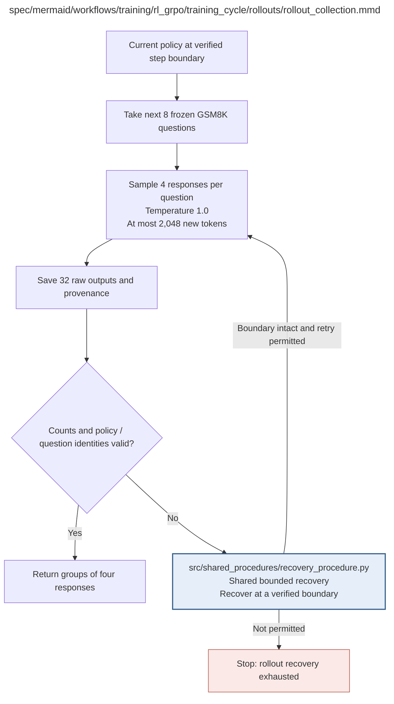

# rollout_collection.md

**Owner:** `rl`. **Implementation status:** blank placeholder, not implemented or tested.

| Artifact | Exact repository path |
|---|---|
| Implementation | `src/training/rl_grpo/training_cycle/rollouts/rollout_collection.py` |
| Workflow/support diagram | [`spec/mermaid/workflows/training/rl_grpo/training_cycle/rollouts/rollout_collection.mmd`](../../../../../../spec/mermaid/workflows/training/rl_grpo/training_cycle/rollouts/rollout_collection.mmd) |
| This specification | `docs/modules/training/rl_grpo/training_cycle/rollouts/rollout_collection.md` |
| Unit test slot | `tests/unit/training/rl_grpo/training_cycle/rollouts/test_rollout_collection.py` |

**Scientific sources:** C.3.2,C.3.5; E.1.4,E.2.6; H.7. [p. 32](../../../../../../spec/experiment.pdf#page=32) · [p. 35](../../../../../../spec/experiment.pdf#page=35) · [p. 52](../../../../../../spec/experiment.pdf#page=52) · [p. 56](../../../../../../spec/experiment.pdf#page=56) · [p. 57](../../../../../../spec/experiment.pdf#page=57) · [p. 77](../../../../../../spec/experiment.pdf#page=77).

## Responsibility and controlling details

At the current verified policy boundary, use the next eight frozen GSM8K questions and sample four responses per question with temperature 1.0, `top_p=1.0`, no top-k restriction, repetition penalty 1.0 and at most 2048 new tokens. Save exactly 32 raw outputs with question/group/completion IDs, policy hash, model identity, attempt and seed/RNG/runtime settings.

Keep ordinary wrong or malformed responses; do not regenerate until correct. Truncated completions that receive invalid-output rewards are not silently removed from policy loss. Bounded execution retries reuse already completed valid rollouts only with matching state/identity; unsafe partial state requires verified recovery. Count and identity checks must verify the actual eight-by-four grouping, not infer it from a scalar batch size.

## Interfaces and dependent procedures

Use the common [artifact contracts](../../../../../contracts.md), [frozen prompt instructions](../../../../../prompts.md), [decision ledger](../../../../../decisions.md) and [validation requirements](../../../../../validation.md). Typed signatures/serialization are delegated implementation details; their scientific meaning is not. The named owner defines this module with its consumers before dependent integration.

| Source node | Called procedure (exact path) | Specification |
|---|---|---|
| `RECOVER` | `src/shared_procedures/recovery_procedure.py` | [recovery_procedure](../../../../shared_procedures/recovery_procedure.md) |

## Original procedural constraints

The following source comments retain the procedural detail of the supplied diagram. Obsolete introductory editing instructions and raw link directives are omitted from this list; all links are resolved in the path-synchronized diagram below. Appendix H controls any earlier conflicting language.
- Policy rollout collection
- Temperature 1.0, max new tokens 2048; include policy hash, attempt ID, seed/RNG and settings.
- Reuse already completed valid rollouts; retry only failed operations.
- Do not resample ordinary wrong or malformed model responses; they receive declared rewards.
- Sampling: top_p=1.0; no top-k restriction; repetition_penalty=1.0.
- Keep invalid truncated completions in the loss; no mask that discards their negative reward.

## Completion and failure boundary

Implement and test `src/training/rl_grpo/training_cycle/rollouts/rollout_collection.py` against its specified behavior in `tests/unit/training/rl_grpo/training_cycle/rollouts/test_rollout_collection.py`. Validate every emitted artifact and preserve its source/configuration identity. Do not claim completeness from a placeholder or passing import. Propagate required child failures and maintain ordinary model outcomes separately from infrastructure faults. Mandatory real preflights and permission gates remain in force. Unspecified allowed conventions must be documented/frozen before outcomes; new scientific choices are not silently authorized.

## Exact path-synchronized diagram

The following diagram is byte-for-byte the active `.mmd` content at generation time. Its procedural content is from the supplied workflow or the cited PDF support requirement; file labels and role assignment are the requested repository organization.

