# sft_fit.md

## Current status: extra epoch complete; GPQA running with provisional observations

The separately identified 14B ROT13 level-10 extra epoch completed on 16 October
from training source `3a89691`: 625 additional/1,250 cumulative updates,
10,000 additional/20,000 cumulative example presentations and 17,996,003 tokens.
Validation loss was `0.6151581262983382` over all 100 cases; 26 required Drive
artifacts, including the final adapter/full checkpoint, are verified and the
trainer exited with code zero. Actual mode remained microbatch 1, accumulation
16, checkpointing off. The recorded fit time was 17,470.26931851078 seconds
(4h51m), about three times the original 96.6-minute fit; the cause is unknown.

The phase retained the parent adapter/AdamW/RNG and used the second seed-42
shuffle, a fresh 625-update cosine with 19 warmup updates at the same peak
`2e-4`, and native thinking-newline alignment with unchanged reasoning/final
bytes and role masks. Teacher-forced loss alone establishes neither spontaneous
encoding nor retained capability. The provisional observations below do not
isolate the effects of exposure, schedule restart or newline alignment.

The new L10 adapter's full 198-question/32,000-token GPQA run is active;
new-adapter inference was observed at 11:52:41 UTC. Frozen evaluator `5e6be1b`
and protocol `57898f795997a55ebfce68cc68d2cc155312e6cd138b4bb2a927fe6cba863f9b`
retain the same prompts, item seeds, sampling and strict scorer in a distinct
namespace. Matching cached base (99/198) and original L10 (98/198, no positives
in the fixed marker screen) remain controls.

A private 13:39:40 UTC snapshot held 42 already-completed requests. A fixed
73-type marker screen flagged 37; independent bounded opening/middle/end review
found sustained ROT13 in their reviewed passages, while five negatives showed
English/math. Of 25 `stop` and 17 `length` requests, all 17 capped outputs looped
(16 marker-positive, one English); decoded technical terms were often garbled.
This completion-biased, question-unmapped subset is provisional: zero new native
raw records and zero official scores existed at that snapshot. Full-response
encoding, prescribed level-10 compliance, comprehension and full-panel accuracy
remain unestablished. The unchanged 198-question run continues; levels 7-9 stay
paused. The [diagnosis and continuation record](../../../../sft_level10_training_diagnosis.md)
links the separate eight-file Drive-verified observational bundle and its hashes;
it is not native evaluation completion.

## Original one-epoch fits and historical GPQA handoff (14 October)

All ten **14B ROT13 SFT levels are complete**, with final adapters, recovery states and results verified in Google Drive. The nine fresh levels 1–9 each reached 625 updates under scientific source `9de8813031da737453f491723a10b305679dc42d`; retained level 10 keeps source `2ea4fb9a7737cff806226366e73743eec5935fad`. The priority queue was observed complete on 14 October 2026, with zero pending or failed publications and its GPU idle. Each independent fit used all 10,000 certified training examples once, a 625-update cosine horizon and 19 warmup updates. KaziText level 10 remains paused at 444/625 with verified full recovery state and no automatic restart. All forty prepared condition datasets and historical 7B results remain available; their availability does not imply completed fits. The next selected work is GPQA Diamond for the untouched 14B base plus all ten ROT13 levels, using the separate `long_32000` evaluation profile. Training, data, recipe and original four-domain evaluation budgets are unchanged. See [the campaign guide](../../../../gpqa_14b_rot13_campaign.md) and [the training record](../../../../sft_completed_rot13_14b_level10.md).

The declared efficient baseline uses an unquantized frozen BF16 base and BF16 head, SDPA with efficient-kernel preference, direct full-gradient Cut Cross-Entropy (`cce_exact`) with FP32 loss and hidden-gradient accumulation, and plain AdamW with FP32 optimizer states. CCE is pinned to upstream commit `3de376c106a1916bc5e1b619f9c77c87a461ee1c`; `filter_eps=None`, `filter_e_grad=False` and `filter_c_grad=False` disable gradient filtering. No Qwen patch or full token-by-vocabulary logits matrix is used. Policy `published_bf16_lora_full_gradient_cce_v2` requests microbatch 2/accumulation 8. A non-updating duplicated-longest-example capacity guard tries 2/off, 1/off, 2/on, then 1/on, where on/off denotes activation checkpointing; only CUDA OOM permits fallback. The selected actual mode is recorded and cannot change during exact recovery.

Keep completion-only masks and per-example weighting, all seven LoRA targets (rank 8/alpha 16/dropout 0.05), learning rate `2e-4`, requested microbatch 2/accumulation 8/effective batch 16 (capacity fallback 1/16/16), seed 42, all 10,000/100 records, full 4096-token eligibility without truncation and verified Drive saves. Checkpoints occur at updates 100, 200, 300, 400, 500, 600 and final 625. Each update retains the same ordered 16 examples with per-example weight 1/16; execution grouping, padding, dropout draws and floating-point rounding may differ. No measured batching speedup or bitwise-equivalent outcome is claimed. This prospectively declared scientific baseline changes exposure, precision/head numerics, optimizer and execution; it does not prove identical final results. The original NF4 `legacy_two_epoch_v1` and intermediate NF4 `one_epoch_pilot_v1` remain explicit alternatives, with incompatible checkpoints and separate identities.

The user requested implementation without another optimization test or timing campaign. Normal native model/mask/gradient/capacity/full-state guards passed for the completed 14B ROT13 level-10 fit on RTX PRO 6000 Blackwell 96GB. Actual execution was microbatch 1 / accumulation 16 with activation checkpointing off. The recorded fit interval was 5,793.143751 seconds (96m33s); worker launch through completion was 6,322.565654 seconds (105m23s). At $2.99/hour these imply $4.81 and $5.25, respectively, calculated from runtime rather than invoices. That standalone L10 timing remains a dated measurement, not a bound for other levels or hardware. Archived PRO step-987 and A100 update-28/30 states remain in Drive, never warm starts for this recipe. One epoch removes 50% of nominal example passes versus the same-condition two-epoch recipe; no one-hour finish or measured hardware speedup is promised. Diagnostics use the 100 certified validation IDs and base companions; final test panels and original confirmatory thresholds remain reserved. No additional training after the completed 625-update cosine horizon is an exact continuation of the old 1,250-update schedule.

See the [completion, provenance and budget record](../../../../sft_completed_rot13_14b_level10.md). The historical untouched 14B GPQA Diamond baseline remains **49/198 (24.75%)**, with 133 truncated and three malformed outputs under its 3,072-token cap; all 198 count. Its Drive-verified records remain separate from the new `long_32000` comparison. The original 14 October launch plan required one matching untouched baseline and ten adapters, totaling 2,178 responses. Its completed baseline and original-adapter results are now retained as described in the current status above; remaining levels 7-9 are paused. Only GPQA receives the larger response/context allowance; GSM8K, MMLU, ARC-Easy and MBPP retain their existing 3,072-token measurement contract. The [GPQA contract](../../../evaluation/supplemental_gpqa.md) and [campaign guide](../../../../gpqa_14b_rot13_campaign.md) describe strict profile/cache isolation and verified Drive publication. KaziText remains suspended and unscheduled.

## Archived interruption: A100 comparison stopped on 11 October 2026

Both Colab A100 assignments ended; the account reports 0.00 compute units and rejects a new A100 allocation. ROT13 and KaziText baseline attempts are safely paused at updates 28 and 30, with full state verified in Drive before runtime loss. Source `8a0f853` implements checkpointed A100 loss candidates, per-level empirical qualification and verified setup reuse. Native candidate comparisons remain incomplete: no optimized fit has started and no A100 speedup is approved. The user requested fresh optimized restarts from untouched bases; archived partial fits are benchmark evidence only. There is no user-imposed wall-clock deadline. See [the interruption record](../../../../evidence/a100_optimization_interruption.json) and [restart procedure](../../../../colab_sft_restart.md).

## Prior implementation and evidence scope

The following implementation details and dated measurements retain their original scope; the completed efficient fit and current authorization are described above.

**Owner:** `sft`. **Implementation status:** source `a6e3295` remains accepted only for 7B ROT13 level 1 on the measured Blackwell96GB GPU. Its existing lineage is running from verified step 673 with passed native gradients, verified Drive recovery and the original deadline. The final memory-copy candidate failed speed despite bitwise agreement. All parent checkpoints and science remain unchanged; optimization rounds are closed.

| Artifact | Exact repository path |
|---|---|
| Implementation | `src/training/sft/individual_fit/sft_fit.py` |
| Workflow/support diagram | [`spec/mermaid/workflows/training/sft/individual_fit/sft_fit.mmd`](../../../../../spec/mermaid/workflows/training/sft/individual_fit/sft_fit.mmd) |
| This specification | `docs/modules/training/sft/individual_fit/sft_fit.md` |
| Unit test slot | `tests/unit/training/sft/individual_fit/test_sft_fit.py` |

**Scientific sources:** C.2.2–C.2.4; E.1.3; E.2.4,E.2.6; H.9. [p. 28](../../../../../spec/experiment.pdf#page=28) · [p. 29](../../../../../spec/experiment.pdf#page=29) · [p. 30](../../../../../spec/experiment.pdf#page=30) · [p. 50](../../../../../spec/experiment.pdf#page=50) · [p. 55](../../../../../spec/experiment.pdf#page=55) · [p. 56](../../../../../spec/experiment.pdf#page=56) · [p. 80](../../../../../spec/experiment.pdf#page=80).

## Responsibility and controlling details

## Default efficient recipe and runtime

| Setting | `efficient_one_epoch_v1` value |
|---|---|
| Objective | Completion-only full assistant target; mean supervised-token loss per example, then mean across examples |
| Base precision | Unquantized frozen BF16 weights; no NF4 quantization |
| Head precision / loss | Frozen BF16 head; CCE FP32 loss and hidden-gradient accumulation |
| Loss implementation | Direct `cce_exact`, pinned upstream; `filter_eps=None`, both gradient-filter flags false |
| Attention | Standard SDPA, with efficient-kernel preference; no observed-kernel claim |
| LoRA | Rank 8, alpha 16, dropout 0.05; all seven attention/MLP projection targets |
| Optimizer / LR | Plain AdamW, FP32 states, learning rate `2e-4`, zero weight decay |
| Schedule | One complete epoch; 625-update cosine horizon, 19 warmup updates |
| Microbatch / accumulation / effective batch | Requested 2 / 8 / 16; capacity fallback 1 / 16 / 16 |
| Max gradient norm / sequence length / seed | 0.3 / 4096, no truncation / 42 |
| Activation checkpointing | Fresh duplicated-longest-example capacity guard: 2/off → 1/off → 2/on → 1/on; restore recorded mode on resume |
| Checkpoints | Full state at every 100 updates and final 625; verified in Drive |

The direct CCE call uses the full vocabulary and full gradients, not a Qwen monkeypatch, pruned gradients or materialized `[tokens, vocabulary]` logits. Native startup checks require valid model identity, causal completion/padding masks, nonzero adapter gradients and recoverable full state before production updates. They are normal operational guards, not another paired optimization campaign, and no current receipt claims they passed for this recipe.

Install through `scripts/setup_environment.py --profile gpu-published --skip-tests`: the unchanged hash-locked base is installed first, then `requirements_sft_published.lock` pins the upstream CCE revision. PyPI version 25.1.1 lacks the required exact-gradient controls and is not an interchangeable dependency.

`legacy_two_epoch_v1` retains NF4/double quantization, FP32 head, paged AdamW and 1,250 updates with 38 warmup updates. `one_epoch_pilot_v1` retains that numerical recipe with 625/19. The efficient recipe changes these numerics and is a newly declared baseline, not an approved migration of a previous optimizer state. Start fresh; only an exact efficient-fit full checkpoint may resume its own fit. A second epoch after final 625 requires a separate continuation declaration or a fresh legacy run.

Use the common [artifact contracts](../../../../contracts.md), [prompt instructions](../../../../prompts.md), [decision ledger](../../../../decisions.md) and [validation requirements](../../../../validation.md). The [deployment plan](../../../../sft_multi_gpu_execution_plan.md) retains completed 14B ROT13 level10 and documents19 remaining selected 14B conditions under the $240 SFT authorization.

| Source node | Called procedure | Specification |
|---|---|---|
| `RECOVER` | `src/shared_procedures/recovery_procedure.py` | [recovery](../../../shared_procedures/recovery_procedure.md) |

## Historical NF4 implementation and evidence

The [causal-gradient helper](../../../../../src/training/sft/causal_gradient_loss.py), `causal_gradient_token_cross_entropy(logits, targets, *, ignore_index=-100)`, moves causal shifting inside custom autograd and writes the complete contiguous token/vocabulary gradient, zeroing only the unused last row. Forward reuses accepted scheduled CE and its coalesced input copy; backward removes separate slice/scatter/layout copies. Source 07f8a68 passed 359 affected CPU checks and both bitwise numerical/state/RNG comparisons, but failed the speed gate: 1.93% less median time in one pair, 0.17% more in the other, minimum matched ratio 0.99834x versus required 1.05x. Peak allocated memory did not improve. The helper is rejected; source a6e3295 scheduled CE remains selected. Its exact existing lineage is running from verified step 673 with passed native gradients, verified Drive recovery and the unchanged deadline. No migration to the rejected source occurs, all parents and science are preserved, and optimization rounds are closed.

The accepted `spatial_scheduled_ce` option uses [scheduled_spatial_token_cross_entropy](../../../../../src/training/sft/scheduled_spatial_loss.py) with the original shifted FP32 logits and targets. It retains serial class-index accumulation, native libdevice exp/log and target-loss arithmetic, schedules 64 tokens per CUDA thread block, stores target losses/row statistics and reconstructs log-probabilities during tiled backward. Shifted sequences of at most 64 tokens explicitly retain original spatial forward; errors never choose another backend. Full head/logits, vocabulary, masks, per-example weighting and RNG behavior stay fixed. Two counterbalanced step-509 recovery pairs passed bitwise losses, gradients, updates and final adapter/optimizer/scheduler/RNG, with 24.70–24.98% less median update time versus accepted spatial-forward/tiled-backward. The longest 3,190-token probe had the same loss and 84.28 GiB allocated/87.32 GiB reserved peak as reference. A total of 236 focused CPU checks and affected launch controls passed; acceptance is limited to the source/GPU/condition binding. This does not prove final-result equivalence, improve all conditions or establish a full-fit ETA.

`loss_implementation` supports original `spatial_ce`, rejected `flat_ce`/`fused_ce`, earlier accepted `spatial_fused_backward`, and current accepted `spatial_scheduled_ce` only under measured source/GPU/condition bindings. The [spatial helper](../../../../../src/training/sft/spatial_loss.py) exposes `spatial_token_cross_entropy(logits, targets, *, ignore_index=-100)`. It retains stock spatial `torch.log_softmax(..., dim=1)` and unreduced `F.nll_loss` forward; only its backward is tiled using the pinned PyTorch epilogue and libdevice exponential. It preserves FP32 logits, the full vocabulary, causal masks and mean-within-example then mean-across-examples weighting, adds no RNG and fails unsupported execution without fallback. Two actual paired step-401 recovery repetitions measured 13.52%/11.65% less median update time versus no recomputation, with bitwise losses, gradients, updates, final adapter/optimizer/scheduler and RNG. The 3,190-token probe allocated 84.28 GiB/reserved 87.32 GiB. Approval is source/GPU/condition-bound; 165 affected CPU checks passed and new runtime controls are READY. The [forward-candidate failures](../../../../evidence/sft_loss_optimization_pro6000_parallel_ce.json) retain their faster timing and failed numerical bounds. These measurements do not guarantee final scientific equivalence or approve other conditions. The new child inherits full step-401 state while preserving parent bytes and source/profile lineage.

Source `05f42b0` adds `cache_collated_inputs` and `gradient_checkpointing` execution controls, defaulting to false and true respectively. The protocol describes checkpointing as a memory-saving execution setting. Identical base freezing, FP32 parameter preparation and LoRA setup precede an explicit no-recomputation override. Immutable CUDA caching retains exact IDs, masks, labels and microbatch shapes with mutation guards, but failed the speed gate and remains disabled. The actual two-repetition step-214 recovery screen accepted only no recomputation for 7B ROT13 level 1 on RTX PRO 6000 Blackwell 96GB: 1.2695x and 1.2806x median throughput ratios, with bitwise loss, gradient, update, final adapter/optimizer/scheduler and RNG agreement. The 3,190-token worst-case probe used 89.13 GiB reserved memory, so this approval is not portable to other conditions. Source/GPU/condition-bound launch evidence and explicit parent-preserving lineage remain required. Learning rate, exposure, dropout, loss weighting and Drive checkpoint cadence stay fixed.

`runtime_migration.py` verifies immutable scientific fields and parent checkpoint bytes, creates separate child provenance and inherits full optimizer/scheduler/sampler/RNG progress. It does not relabel the original checkpoint as an exact new-source resume. The official parent is read-only during paired recovery measurements and migration.

`SFTExecutionProfile` separates explicit execution candidates from the frozen `SFTRecipe`. Baseline remains eager attention with original checks. The redundant-check candidate validates supervised counts on CPU with tensor identity/mutation guards and checks all detached microbatch losses once before clipping or updating. Its CE/reduction/update order and RNG are unchanged on bitwise CPU comparisons. `one_optimizer_update` is shared by the real loop and isolated benchmark; resume progress rejects a different execution profile. The [actual Blackwell comparison](../../../../evidence/sft_optimization_pro6000_benchmark.json) retained bitwise losses, gradients, adapter updates and final RNG for deferred checks, but its 1.0020x speed ratio failed the 5% screen. SDPA was 0.9937x and failed the numerical screen; the selected kernel was not independently observed. Neither candidate is activated. See [precedent and empirical limits](../../../../sft_optimizations.md). A short fresh-state benchmark and the old H100 receipt do not approve a production checkpoint migration.

`SFTFitSpec(family, model_id, level, model_revision, tokenizer_revision, configuration_hash, dataset_hash)` freezes an exact fit. `run_sft_fit(spec, train_records, validation_records, output_dir, config, *, resume=None, preflight_report=None, should_pause=None, handoff_certificate=None, execution_profile=None, execution_benchmark=None)` runs the actual Transformers/PEFT/BitsAndBytes engine. `verify_fit_result(output_dir, expected_identity)` reopens the final checkpoint and verifies adapter tensors against it. Heavy GPU imports occur only in the actual engine.

`render_sft_completion(prompt, completion, tokenizer)` is the shared training renderer used by source length validation and fitting. Both official R1 tokenizer templates remove historical assistant reasoning before `</think>`; this renderer obtains their native role/end wrappers with a sentinel and inserts the complete target without a system message. Native evaluation generation retains the published template. The prospective H.9 convention is `native_training_template_v1`; reduction is the supervised-token mean per example, then the mean across examples. The explicitly named NF4 pilot single seeded epoch gives exactly 10,000 presentations and 625 optimizer updates; 3% warmup rounds upward to 19. The explicitly named legacy recipe retains two seeded permutations, 20,000 presentations, 1,250 updates and 38 warmup updates. Recipe identity is part of checkpoint compatibility: changing epochs or the scheduler horizon cannot relabel an old checkpoint as a pilot resume.

`tokenize_completion` requires exact offset boundaries, masks prompt and padding positions, supervises the whole target and native end token, and rejects overlength examples without truncation. All records in a fit must bind to one accepted source-pool hash. Checks require exact counts, disjoint unique IDs, prompt-byte hashes, transformation seed, model/tokenizer revisions, configuration and complete target composition.

Full checkpoints save LoRA tensors, optimizer, scheduler, Python/NumPy/Torch/CUDA RNG and exact sampler position every 100 completed updates and at completion. Atomic pause boundaries also save full state. Corrupt claimed checkpoints are recorded, and recovery uses the latest verified complete point or stops when none verifies. The checkpoint callback publishes required files before older checkpoints are removed. A fault restart consumes the shared worker retry ledger for its exact restored step; a verified voluntary pause is a continuation. The ledger persists independently of rollback, with three retries per operation and 100 per worker. Final safe artifact repairs reuse the trained state and the same ledger.

Final publication atomically writes a safetensors adapter and tokenizer plus a manifest tied to the completed full checkpoint. Validation loss uses all 100 held-out records without an update or model selection. Reopening a result verifies its payload hashes and exact adapter tensors against the checkpoint. No CPU fixture or selected tokenizer test authorizes a live GPU fit.

The [unit tests](../../../../../tests/unit/training/sft/individual_fit/test_sft_fit.py) exercise independently computed masked cross-entropy and prompt/padding gradients, actual tiny-model optimizer updates, held-out loss without mutation, dropout/RNG/optimizer/scheduler resume equivalence, actual seven-target PEFT gradients and safetensors integrity, checkpoint cadence, source integrity and persistent restart budgets. The coordinator records exact commands/results in `artifacts/preflight/sft_implementation_report.json`. Both immutable official tokenizers were separately acquired through verified HTTPS Git-blob hashes and loaded locally; selected-model CUDA memory, mask/gradient and full-state recovery preflights remain required.

## Original procedural constraints

The following source comments retain the procedural detail of the supplied diagram. Obsolete introductory editing instructions and raw link directives are omitted from this list; all links are resolved in the path-synchronized diagram below. Appendix H controls any earlier conflicting language.
- Individual SFT fit
- Execution contract: known faults use bounded recovery; unclassified/persistent faults stop the worker.
- Frozen invalid inputs are fatal. Unrecoverable child failures propagate; never release incomplete results.
- Individual SFT fit
- No warm-start from another level; only an exact-fit full checkpoint may resume training.
- SFT setup and resumption
- NF4 double quantization, BF16, gradient checkpointing.
- LoRA rank 8 / alpha 16 / dropout .05; attention and MLP targets.
- LR 2e-4; paged AdamW32; cosine schedule; warmup 3%; weight decay 0.
- Microbatch 1; gradient accumulation 16; effective batch 16; max length 4096; seed 42.
- Known setup failures use shared bounded recovery before this procedure returns STOP.
- A corrupt claimed recovery checkpoint must not silently cause a fresh run with overwritten provenance.
- SFT optimization
- Full checkpoint includes adapter, optimizer, scheduler, RNG and data position.
- Interrupted updates roll back to a verified full checkpoint; counters survive rollback.
- If interruption occurs before the first checkpoint, an explicitly recorded fresh restart uses the fixed seed.
- No early stopping; scientific validation results cannot alter the fixed two-epoch schedule.
- SFT final validation and saving
- Retain already valid upstream artifacts; retry only the failed save or validation computation.
- Validation loss is reported; it does not trigger early stopping or extra training.
- SETUP verifies full checkpoint identity/integrity or initializes an untouched base; corrupt existing recovery state is not silently discarded.
- SETUP applies masking, gradient and data-identity checks before any update. Effective batch 16 and max length 4096.
- AUDIT->FINAL permits only a known safe artifact repair within persistent finite retry budgets. Frozen-input faults stop.
- Retry only the failed final save / validation operation; retain valid upstream outputs and trained state.
- Interrupted updates require rollback to verified state; replay is recorded and never resets retry counters.

## Completion and failure boundary

Implement and test `src/training/sft/individual_fit/sft_fit.py` against its specified behavior in `tests/unit/training/sft/individual_fit/test_sft_fit.py`. Validate every emitted artifact and preserve its source/configuration identity. Do not claim completeness from a placeholder or passing import. Propagate required child failures and maintain ordinary model outcomes separately from infrastructure faults. Mandatory real preflights and permission gates remain in force. Unspecified allowed conventions must be documented/frozen before outcomes; new scientific choices are not silently authorized.

## Exact path-synchronized diagram

The following diagram is byte-for-byte the active `.mmd` content at generation time. Its procedural content is from the supplied workflow or the cited PDF support requirement; file labels and role assignment are the requested repository organization.

```mermaid
---
title: "spec/mermaid/workflows/training/sft/individual_fit/sft_fit.mmd"
---
flowchart TD
%% 16Oct separate L10 extra epoch COMPLETE625/cumulative1250; original fit remains immutable.
%% 26 Drive artifacts verified; trainer exit0. New-L10 GPQA inference observed11:52:41UTC.
%% 13:39:40 provisional42completed:37 sustained in reviewed passages,17capped loop.
%% Completion-biased/unmapped; no target-level/comprehension/accuracy claim; full198pending.
%% New phase changes exposure, restarted schedule and native think-newline serialization.
%% Preserved AdamW/RNG/physical mode; no claimed benefit or pure-epoch causal isolation.
%% efficient_one_epoch_v1: BF16 unquantized base/head, full-gradient direct CCE, SDPA, AdamW.
%% CCE pinned upstream; filter_eps=None, filter_e_grad=False, filter_c_grad=False.
%% FP32 loss and hidden-gradient accumulation; no gradient pruning or Qwen patch.
%% No materialized full token-by-vocabulary logits; no equivalence to historical FP32 head promised.
%% All 10,000 examples once; 625 updates and 19 warmup; request micro 2 / accumulation 8 / effective 16.
%% Capacity fallback micro 1 / accumulation 16; same ordered 16 examples/update, per-example weight 1/16.
%% Execution grouping, padding, dropout draws and rounding differ; no measured batching speedup.
%% Completion-only per-example means; full 4096 eligibility without truncation; seed 42.
%% LoRA 8 / 16 / .05, all seven projections, LR 2e-4, zero decay, max norm .3.
%% Checkpoints every 100 updates and final 625; actual Drive verification before retention/completion.
%% Observed: 14B ROT13 L10 completed 625 with native guards passed; actual 1 x 16, checkpointing off.
%% Final adapter/full state Drive-verified; source 2ea4fb9/config 6f7e5048 remain immutable.
%% Allten14B ROT13 fitscomplete625 and Drive-verified; KaziTextL10 paused444, noautomaticrestart.
%% Fresh non-updating duplicate-longest capacity guard: 2/off, 1/off, 2/on, 1/on; CUDA-OOM-only fallback.
%% Exact-fit recovery restores recorded actual batch/accumulation/recomputation, never changes it.
%% Policy v2 has a distinct execution identity; old NF4 or prior-policy states cannot be relabelled.
%% Child: RECOVER => ../../../shared_procedures/recovery_procedure.mmd
    INPUT["Generic explicitly selected condition<br/>Allten14B ROT13 fits alreadycomplete<br/>No retraining for evaluationbudget changes"]
    SETUP["Untouched BF16 base/head and LoRA<br/>Pinned exact full-gradient CCE; SDPA; AdamW<br/>One epoch; cosine 625; warmup 19"]
    CAPACITY["Non-updating duplicate-longest capacity guard<br/>Fresh: 2/off - 1/off - 2/on - 1/on<br/>Only CUDA OOM permits next mode<br/>Resume: restore recorded actual mode"]
    GUARDS["Normal native identity / causal mask / gradient guards<br/>Verify complete-state recovery before updates"]
    DONE{"625 updates complete?"}
    STEP["Next complete optimizer update<br/>Same ordered 16 examples; each weight 1/16<br/>Actual 2 x 8 or fallback 1 x 16"]
    DUE{"Save due?<br/>Every 100 updates or final 625"}
    SAVE["Atomic adapter / optimizer / scheduler / RNG / sampler<br/>Verify actual full state in Drive"]
    FINAL["Verified final adapter and full state<br/>Loss on all 100 certified validation items<br/>Final panels remain reserved"]
    AUDIT{"Final outputs and exposure valid?"}
    OUT["Mark exact selected fit complete"]
    RECOVER["src/shared_procedures/recovery_procedure.py<br/>Shared bounded recovery<br/>Verified exact-recipe full state only"]
    STOP["Stop fit; preserve verified partial state"]
    PARENT["Explicit separate L10 additional-epoch authorization<br/>Verify original complete adapter / full state / data<br/>Restore adapter, AdamW moments / counters and RNG"]
    CONT["src/training/sft/continuation.py<br/>New identity; second seed42 shuffle; 625 extra updates<br/>Fresh cosine / 19 warmup / same peak LR 2e-4<br/>Add native think newline; retain reasoning / final bytes"]
    CONTEND["New adapter/full state and26 artifacts Drive-verified<br/>625 extra/1250 cumulative updates; trainer exit0<br/>Loss .615158 on100; original endpoint retained"]
    POST["Running: one new-adapter L10 GPQA comparison<br/>Same198 questions /32k frozen5e6 settings and seeds<br/>New namespace; reuse cached baseline / original L10<br/>Provisional42 snapshot; native results pending<br/>Levels7-9 paused; no isolated epoch-effect claim"]
    INPUT --> SETUP --> CAPACITY --> GUARDS --> DONE
    DONE -->|No| STEP --> DUE
    DUE -->|Yes| SAVE --> DONE
    DUE -->|No| DONE
    DONE -->|Yes| FINAL --> AUDIT
    AUDIT -->|Yes| OUT
    OUT -.->|Separately authorized L10 phase| PARENT --> CONT --> CONTEND
    CONTEND -->|Complete625 and actual Drive verification| POST
    AUDIT -->|Known artifact repair only| FINAL
    SETUP -.->|Execution failure| RECOVER
    GUARDS -.->|Execution failure| RECOVER
    STEP -.->|Execution failure| RECOVER
    SAVE -.->|Execution failure| RECOVER
    FINAL -.->|Execution failure| RECOVER
    RECOVER -->|Verified matching state| SETUP
    RECOVER -->|Fatal or retry limit| STOP
    AUDIT -.->|Invalid inputs or retry limit| STOP
    classDef detail fill:#e5eef9,stroke:#365f8a,stroke-width:2px
    class RECOVER detail
    classDef stop fill:#fbe9e7,stroke:#b45448
    class STOP stop

%% Repository module: src/training/sft/individual_fit/sft_fit.py
%% Module documentation: docs/modules/training/sft/individual_fit/sft_fit.md
%% Unit test: tests/unit/training/sft/individual_fit/test_sft_fit.py
%% Owner: sft
%% Source sections: C.2.2-C.2.4; E.1.3; E.2.4,E.2.6; H.9; authorized efficient redesign
```

