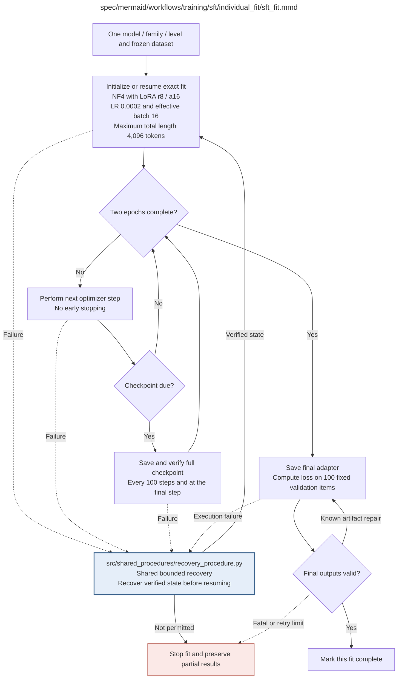

# sft_fit.md

**Owner:** `sft`. **Implementation status:** blank placeholder, not implemented or tested.

| Artifact | Exact repository path |
|---|---|
| Implementation | `src/training/sft/individual_fit/sft_fit.py` |
| Workflow/support diagram | [`spec/mermaid/workflows/training/sft/individual_fit/sft_fit.mmd`](../../../../../spec/mermaid/workflows/training/sft/individual_fit/sft_fit.mmd) |
| This specification | `docs/modules/training/sft/individual_fit/sft_fit.md` |
| Unit test slot | `tests/unit/training/sft/individual_fit/test_sft_fit.py` |

**Scientific sources:** C.2.2–C.2.4; E.1.3; E.2.4,E.2.6; H.9. [p. 28](../../../../../spec/experiment.pdf#page=28) · [p. 29](../../../../../spec/experiment.pdf#page=29) · [p. 30](../../../../../spec/experiment.pdf#page=30) · [p. 50](../../../../../spec/experiment.pdf#page=50) · [p. 55](../../../../../spec/experiment.pdf#page=55) · [p. 56](../../../../../spec/experiment.pdf#page=56) · [p. 80](../../../../../spec/experiment.pdf#page=80).

## Responsibility and controlling details

## Fixed recipe

| Setting | Source value |
|---|---|
| Objective | Completion-only SFT on full assistant target: transformed reasoning plus unchanged final answer |
| Quantization | 4-bit NF4 with double quantization |
| Compute | BF16; gradient checkpointing enabled |
| LoRA | rank 8, scaling alpha 16, dropout 0.05 |
| Projection targets | `q_proj`, `k_proj`, `v_proj`, `o_proj`, `gate_proj`, `up_proj`, `down_proj` |
| Embeddings/LM head | frozen |
| Learning rate | `2e-4` |
| Optimizer | paged AdamW, 32-bit state |
| Schedule | cosine, 3% warmup |
| Weight decay | 0 |
| Max gradient norm | 0.3 |
| Exposure | two epochs, no early stopping |
| Microbatch / accumulation / effective batch | 1 / 16 / 16 |
| Max total sequence length | 4096 |
| Seed | 42 |
| Full-state checkpoint | every 100 optimizer steps and at completion |

Prompt and padding positions receive no loss. Supervise the entire assistant target, not only encoded/degraded tokens. Freeze the permitted loss-reduction rule and runtime defaults under H.9; the PDF's displayed sum does not uniquely prescribe a reduction normalization. Do not silently truncate transformed examples or remove their final answer. Real mask correctness and nonzero LoRA gradients require preflight on the selected runtime, not just inspecting parameter names.

Start fresh from the exact untouched base unless a verified matching full-state checkpoint exists. Invalid claimed checkpoints cannot silently cause overwritten fresh runs. Full recovery requires weights, optimizer/scheduler, completed step, available RNG/sampler/data position, model/tokenizer/code/dependency/configuration and data hashes. Interrupted partially updated state requires rollback; persistent retry counters survive. A restart before the first saved state must preserve recipe/seed and log the replay attempt.

After two epochs save the final adapter and compute validation loss on the fixed 100 held-out items. That loss does not select epochs, cause early stopping or authorize extra training. Reopen and verify final artifacts; bounded safe artifact repairs preserve the trained state and valid upstream results. Keep the latest two full recovery points plus the named final adapter. A complete fit is not itself evidence the model meets construction criteria.

## Interfaces and dependent procedures

Use the common [artifact contracts](../../../../contracts.md), [frozen prompt instructions](../../../../prompts.md), [decision ledger](../../../../decisions.md) and [validation requirements](../../../../validation.md). Typed signatures/serialization are delegated implementation details; their scientific meaning is not. The named owner defines this module with its consumers before dependent integration.

| Source node | Called procedure (exact path) | Specification |
|---|---|---|
| `RECOVER` | `src/shared_procedures/recovery_procedure.py` | [recovery_procedure](../../../shared_procedures/recovery_procedure.md) |

## Original procedural constraints

The following source comments retain the procedural detail of the supplied diagram. Obsolete introductory editing instructions and raw link directives are omitted from this list; all links are resolved in the path-synchronized diagram below. Appendix H controls any earlier conflicting language.
- Individual SFT fit
- Execution contract: known faults use bounded recovery; unclassified/persistent faults stop the worker.
- Frozen invalid inputs are fatal. Unrecoverable child failures propagate; never release incomplete results.
- Individual SFT fit
- No warm-start from another level; only an exact-fit full checkpoint may resume training.
- SFT setup and resumption
- NF4 double quantization, BF16, gradient checkpointing.
- LoRA rank 8 / alpha 16 / dropout .05; attention and MLP targets.
- LR 2e-4; paged AdamW32; cosine schedule; warmup 3%; weight decay 0.
- Microbatch 1; gradient accumulation 16; effective batch 16; max length 4096; seed 42.
- Known setup failures use shared bounded recovery before this procedure returns STOP.
- A corrupt claimed recovery checkpoint must not silently cause a fresh run with overwritten provenance.
- SFT optimization
- Full checkpoint includes adapter, optimizer, scheduler, RNG and data position.
- Interrupted updates roll back to a verified full checkpoint; counters survive rollback.
- If interruption occurs before the first checkpoint, an explicitly recorded fresh restart uses the fixed seed.
- No early stopping; scientific validation results cannot alter the fixed two-epoch schedule.
- SFT final validation and saving
- Retain already valid upstream artifacts; retry only the failed save or validation computation.
- Validation loss is reported; it does not trigger early stopping or extra training.
- SETUP verifies full checkpoint identity/integrity or initializes an untouched base; corrupt existing recovery state is not silently discarded.
- SETUP applies masking, gradient and data-identity checks before any update. Effective batch 16 and max length 4096.
- AUDIT->FINAL permits only a known safe artifact repair within persistent finite retry budgets. Frozen-input faults stop.
- Retry only the failed final save / validation operation; retain valid upstream outputs and trained state.
- Interrupted updates require rollback to verified state; replay is recorded and never resets retry counters.

## Completion and failure boundary

Implement and test `src/training/sft/individual_fit/sft_fit.py` against its specified behavior in `tests/unit/training/sft/individual_fit/test_sft_fit.py`. Validate every emitted artifact and preserve its source/configuration identity. Do not claim completeness from a placeholder or passing import. Propagate required child failures and maintain ordinary model outcomes separately from infrastructure faults. Mandatory real preflights and permission gates remain in force. Unspecified allowed conventions must be documented/frozen before outcomes; new scientific choices are not silently authorized.

## Exact path-synchronized diagram

The following diagram is byte-for-byte the active `.mmd` content at generation time. Its procedural content is from the supplied workflow or the cited PDF support requirement; file labels and role assignment are the requested repository organization.

