# sft_fit.md

## Current session: paused on 11 October 2026

At **7:19 PM EDT**, the accepted 7B ROT13 level-1 fit was safely paused at **step 987 of 1,250** through its whole-update handler. The [pause receipt](../../../../evidence/sft_pro6000_session_pause_987.json) verifies the full adapter, optimizer, scheduler, RNG and sampler checkpoint in Google Drive. There are 263 optimizer updates remaining; training and final validation are not complete. The Pod may be stopped through the RunPod console. Resume from the verified full checkpoint under the existing scientific identity; if the original deadline has elapsed, a new authorized deadline is required. This session pause supersedes earlier RUNNING snapshots without changing their historical evidence. No additional workers have been deployed.

**Owner:** `sft`. **Implementation status:** source `a6e3295` remains accepted only for 7B ROT13 level 1 on the measured Blackwell96GB GPU. Its existing lineage is running from verified step 673 with passed native gradients, verified Drive recovery and the original deadline. The final memory-copy candidate failed speed despite bitwise agreement. All parent checkpoints and science remain unchanged; optimization rounds are closed.

| Artifact | Exact repository path |
|---|---|
| Implementation | `src/training/sft/individual_fit/sft_fit.py` |
| Workflow/support diagram | [`spec/mermaid/workflows/training/sft/individual_fit/sft_fit.mmd`](../../../../../spec/mermaid/workflows/training/sft/individual_fit/sft_fit.mmd) |
| This specification | `docs/modules/training/sft/individual_fit/sft_fit.md` |
| Unit test slot | `tests/unit/training/sft/individual_fit/test_sft_fit.py` |

**Scientific sources:** C.2.2–C.2.4; E.1.3; E.2.4,E.2.6; H.9. [p. 28](../../../../../spec/experiment.pdf#page=28) · [p. 29](../../../../../spec/experiment.pdf#page=29) · [p. 30](../../../../../spec/experiment.pdf#page=30) · [p. 50](../../../../../spec/experiment.pdf#page=50) · [p. 55](../../../../../spec/experiment.pdf#page=55) · [p. 56](../../../../../spec/experiment.pdf#page=56) · [p. 80](../../../../../spec/experiment.pdf#page=80).

## Responsibility and controlling details

## Fixed recipe

| Setting | Source value |
|---|---|
| Objective | Completion-only SFT on full assistant target: transformed reasoning plus unchanged final answer |
| Quantization | 4-bit NF4 with double quantization |
| Compute | BF16; original activation-checkpointing default enabled; an accepted explicit execution profile may override recomputation |
| LoRA | rank 8, scaling alpha 16, dropout 0.05 |
| Projection targets | `q_proj`, `k_proj`, `v_proj`, `o_proj`, `gate_proj`, `up_proj`, `down_proj` |
| Embeddings/LM head | frozen |
| Learning rate | `2e-4` |
| Optimizer | paged AdamW, 32-bit state |
| Schedule | cosine, 3% warmup |
| Weight decay | 0 |
| Max gradient norm | 0.3 |
| Exposure | two epochs, no early stopping |
| Microbatch / accumulation / effective batch | 1 / 16 / 16 |
| Max total sequence length | 4096 |
| Seed | 42 |
| Full-state checkpoint | every 100 optimizer steps and at completion |

Prompt and padding positions receive no loss. Supervise the entire assistant target, not only encoded/degraded tokens. Freeze the permitted loss-reduction rule and runtime defaults under H.9; the PDF's displayed sum does not uniquely prescribe a reduction normalization. Do not silently truncate transformed examples or remove their final answer. Real mask correctness and nonzero LoRA gradients require preflight on the selected runtime, not just inspecting parameter names.

Start fresh from the exact untouched base unless a verified matching full-state checkpoint exists. Invalid claimed checkpoints cannot silently cause overwritten fresh runs. Full recovery requires weights, optimizer/scheduler, completed step, available RNG/sampler/data position, model/tokenizer/code/dependency/configuration and data hashes. Interrupted partially updated state requires rollback; persistent retry counters survive. A restart before the first saved state must preserve recipe/seed and log the replay attempt.

After two epochs save the final adapter and compute validation loss on the fixed 100 held-out items. That loss does not select epochs, cause early stopping or authorize extra training. Reopen and verify final artifacts; bounded safe artifact repairs preserve the trained state and valid upstream results. Keep the latest two full recovery points plus the named final adapter. A complete fit is not itself evidence the model meets construction criteria.

## Interfaces and dependent procedures

The [proposed four-worker plan](../../../../sft_multi_gpu_execution_plan.md) assigns whole independent fits, without distributing a logical optimizer update across GPUs. Each condition has one owner, separate adapter/optimizer/scheduler/sampler state and immutable verified Drive outputs. The currently owned 7B ROT13 level-1 fit is excluded from new queues. Additional A100/14B capacity and profiles remain unvalidated; the original checkpointed baseline is only a capacity candidate. Current optimized helpers require SM120 and pinned Triton 3.5.0, so a hardware change requires affected source/runtime evidence and any continuation provenance before launch. No additional worker deployment is claimed.

Use the common [artifact contracts](../../../../contracts.md), [frozen prompt instructions](../../../../prompts.md), [decision ledger](../../../../decisions.md) and [validation requirements](../../../../validation.md). Typed signatures/serialization are delegated implementation details; their scientific meaning is not. The named owner defines this module with its consumers before dependent integration.

| Source node | Called procedure (exact path) | Specification |
|---|---|---|
| `RECOVER` | `src/shared_procedures/recovery_procedure.py` | [recovery_procedure](../../../shared_procedures/recovery_procedure.md) |

## Implemented interface and evidence

The [causal-gradient helper](../../../../../src/training/sft/causal_gradient_loss.py), `causal_gradient_token_cross_entropy(logits, targets, *, ignore_index=-100)`, moves causal shifting inside custom autograd and writes the complete contiguous token/vocabulary gradient, zeroing only the unused last row. Forward reuses accepted scheduled CE and its coalesced input copy; backward removes separate slice/scatter/layout copies. Source 07f8a68 passed 359 affected CPU checks and both bitwise numerical/state/RNG comparisons, but failed the speed gate: 1.93% less median time in one pair, 0.17% more in the other, minimum matched ratio 0.99834x versus required 1.05x. Peak allocated memory did not improve. The helper is rejected; source a6e3295 scheduled CE remains selected. Its exact existing lineage is running from verified step 673 with passed native gradients, verified Drive recovery and the unchanged deadline. No migration to the rejected source occurs, all parents and science are preserved, and optimization rounds are closed.

The accepted `spatial_scheduled_ce` option uses [scheduled_spatial_token_cross_entropy](../../../../../src/training/sft/scheduled_spatial_loss.py) with the original shifted FP32 logits and targets. It retains serial class-index accumulation, native libdevice exp/log and target-loss arithmetic, schedules 64 tokens per CUDA thread block, stores target losses/row statistics and reconstructs log-probabilities during tiled backward. Shifted sequences of at most 64 tokens explicitly retain original spatial forward; errors never choose another backend. Full head/logits, vocabulary, masks, per-example weighting and RNG behavior stay fixed. Two counterbalanced step-509 recovery pairs passed bitwise losses, gradients, updates and final adapter/optimizer/scheduler/RNG, with 24.70–24.98% less median update time versus accepted spatial-forward/tiled-backward. The longest 3,190-token probe had the same loss and 84.28 GiB allocated/87.32 GiB reserved peak as reference. A total of 236 focused CPU checks and affected launch controls passed; acceptance is limited to the source/GPU/condition binding. This does not prove final-result equivalence, improve all conditions or establish a full-fit ETA.

`loss_implementation` supports original `spatial_ce`, rejected `flat_ce`/`fused_ce`, earlier accepted `spatial_fused_backward`, and current accepted `spatial_scheduled_ce` only under measured source/GPU/condition bindings. The [spatial helper](../../../../../src/training/sft/spatial_loss.py) exposes `spatial_token_cross_entropy(logits, targets, *, ignore_index=-100)`. It retains stock spatial `torch.log_softmax(..., dim=1)` and unreduced `F.nll_loss` forward; only its backward is tiled using the pinned PyTorch epilogue and libdevice exponential. It preserves FP32 logits, the full vocabulary, causal masks and mean-within-example then mean-across-examples weighting, adds no RNG and fails unsupported execution without fallback. Two actual paired step-401 recovery repetitions measured 13.52%/11.65% less median update time versus no recomputation, with bitwise losses, gradients, updates, final adapter/optimizer/scheduler and RNG. The 3,190-token probe allocated 84.28 GiB/reserved 87.32 GiB. Approval is source/GPU/condition-bound; 165 affected CPU checks passed and new runtime controls are READY. The [forward-candidate failures](../../../../evidence/sft_loss_optimization_pro6000_parallel_ce.json) retain their faster timing and failed numerical bounds. These measurements do not guarantee final scientific equivalence or approve other conditions. The new child inherits full step-401 state while preserving parent bytes and source/profile lineage.

Source `05f42b0` adds `cache_collated_inputs` and `gradient_checkpointing` execution controls, defaulting to false and true respectively. The protocol describes checkpointing as a memory-saving execution setting. Identical base freezing, FP32 parameter preparation and LoRA setup precede an explicit no-recomputation override. Immutable CUDA caching retains exact IDs, masks, labels and microbatch shapes with mutation guards, but failed the speed gate and remains disabled. The actual two-repetition step-214 recovery screen accepted only no recomputation for 7B ROT13 level 1 on RTX PRO 6000 Blackwell 96GB: 1.2695x and 1.2806x median throughput ratios, with bitwise loss, gradient, update, final adapter/optimizer/scheduler and RNG agreement. The 3,190-token worst-case probe used 89.13 GiB reserved memory, so this approval is not portable to other conditions. Source/GPU/condition-bound launch evidence and explicit parent-preserving lineage remain required. Learning rate, exposure, dropout, loss weighting and Drive checkpoint cadence stay fixed.

`runtime_migration.py` verifies immutable scientific fields and parent checkpoint bytes, creates separate child provenance and inherits full optimizer/scheduler/sampler/RNG progress. It does not relabel the original checkpoint as an exact new-source resume. The official parent is read-only during paired recovery measurements and migration.

`SFTExecutionProfile` separates explicit execution candidates from the frozen `SFTRecipe`. Baseline remains eager attention with original checks. The redundant-check candidate validates supervised counts on CPU with tensor identity/mutation guards and checks all detached microbatch losses once before clipping or updating. Its CE/reduction/update order and RNG are unchanged on bitwise CPU comparisons. `one_optimizer_update` is shared by the real loop and isolated benchmark; resume progress rejects a different execution profile. The [actual Blackwell comparison](../../../../evidence/sft_optimization_pro6000_benchmark.json) retained bitwise losses, gradients, adapter updates and final RNG for deferred checks, but its 1.0020x speed ratio failed the 5% screen. SDPA was 0.9937x and failed the numerical screen; the selected kernel was not independently observed. Neither candidate is activated. See [precedent and empirical limits](../../../../sft_optimizations.md). A short fresh-state benchmark and the old H100 receipt do not approve a production checkpoint migration.

`SFTFitSpec(family, model_id, level, model_revision, tokenizer_revision, configuration_hash, dataset_hash)` freezes an exact fit. `run_sft_fit(spec, train_records, validation_records, output_dir, config, *, resume=None, preflight_report=None, should_pause=None, handoff_certificate=None, execution_profile=None, execution_benchmark=None)` runs the actual Transformers/PEFT/BitsAndBytes engine. `verify_fit_result(output_dir, expected_identity)` reopens the final checkpoint and verifies adapter tensors against it. Heavy GPU imports occur only in the actual engine.

`render_sft_completion(prompt, completion, tokenizer)` is the shared training renderer used by source length validation and fitting. Both official R1 tokenizer templates remove historical assistant reasoning before `</think>`; this renderer obtains their native role/end wrappers with a sentinel and inserts the complete target without a system message. Native evaluation generation retains the published template. The prospective H.9 convention is `native_training_template_v1`; reduction is the supervised-token mean per example, then the mean across examples. Continuous accumulation across the two seeded epoch permutations gives exactly 20,000 presentations and 1,250 optimizer updates. The 3% warmup rounds upward to 38 updates.

`tokenize_completion` requires exact offset boundaries, masks prompt and padding positions, supervises the whole target and native end token, and rejects overlength examples without truncation. All records in a fit must bind to one accepted source-pool hash. Checks require exact counts, disjoint unique IDs, prompt-byte hashes, transformation seed, model/tokenizer revisions, configuration and complete target composition.

Full checkpoints save LoRA tensors, optimizer, scheduler, Python/NumPy/Torch/CUDA RNG and exact sampler position every 100 completed updates and at completion. Atomic pause boundaries also save full state. Corrupt claimed checkpoints are recorded, and recovery uses the latest verified complete point or stops when none verifies. The checkpoint callback publishes required files before older checkpoints are removed. A fault restart consumes the shared worker retry ledger for its exact restored step; a verified voluntary pause is a continuation. The ledger persists independently of rollback, with three retries per operation and 100 per worker. Final safe artifact repairs reuse the trained state and the same ledger.

Final publication atomically writes a safetensors adapter and tokenizer plus a manifest tied to the completed full checkpoint. Validation loss uses all 100 held-out records without an update or model selection. Reopening a result verifies its payload hashes and exact adapter tensors against the checkpoint. No CPU fixture or selected tokenizer test authorizes a live GPU fit.

The [unit tests](../../../../../tests/unit/training/sft/individual_fit/test_sft_fit.py) exercise independently computed masked cross-entropy and prompt/padding gradients, actual tiny-model optimizer updates, held-out loss without mutation, dropout/RNG/optimizer/scheduler resume equivalence, actual seven-target PEFT gradients and safetensors integrity, checkpoint cadence, source integrity and persistent restart budgets. The coordinator records exact commands/results in `artifacts/preflight/sft_implementation_report.json`. Both immutable official tokenizers were separately acquired through verified HTTPS Git-blob hashes and loaded locally; selected-model CUDA memory, mask/gradient and full-state recovery preflights remain required.

## Original procedural constraints

The following source comments retain the procedural detail of the supplied diagram. Obsolete introductory editing instructions and raw link directives are omitted from this list; all links are resolved in the path-synchronized diagram below. Appendix H controls any earlier conflicting language.
- Individual SFT fit
- Execution contract: known faults use bounded recovery; unclassified/persistent faults stop the worker.
- Frozen invalid inputs are fatal. Unrecoverable child failures propagate; never release incomplete results.
- Individual SFT fit
- No warm-start from another level; only an exact-fit full checkpoint may resume training.
- SFT setup and resumption
- NF4 double quantization, BF16, gradient checkpointing.
- LoRA rank 8 / alpha 16 / dropout .05; attention and MLP targets.
- LR 2e-4; paged AdamW32; cosine schedule; warmup 3%; weight decay 0.
- Microbatch 1; gradient accumulation 16; effective batch 16; max length 4096; seed 42.
- Known setup failures use shared bounded recovery before this procedure returns STOP.
- A corrupt claimed recovery checkpoint must not silently cause a fresh run with overwritten provenance.
- SFT optimization
- Full checkpoint includes adapter, optimizer, scheduler, RNG and data position.
- Interrupted updates roll back to a verified full checkpoint; counters survive rollback.
- If interruption occurs before the first checkpoint, an explicitly recorded fresh restart uses the fixed seed.
- No early stopping; scientific validation results cannot alter the fixed two-epoch schedule.
- SFT final validation and saving
- Retain already valid upstream artifacts; retry only the failed save or validation computation.
- Validation loss is reported; it does not trigger early stopping or extra training.
- SETUP verifies full checkpoint identity/integrity or initializes an untouched base; corrupt existing recovery state is not silently discarded.
- SETUP applies masking, gradient and data-identity checks before any update. Effective batch 16 and max length 4096.
- AUDIT->FINAL permits only a known safe artifact repair within persistent finite retry budgets. Frozen-input faults stop.
- Retry only the failed final save / validation operation; retain valid upstream outputs and trained state.
- Interrupted updates require rollback to verified state; replay is recorded and never resets retry counters.

## Completion and failure boundary

Implement and test `src/training/sft/individual_fit/sft_fit.py` against its specified behavior in `tests/unit/training/sft/individual_fit/test_sft_fit.py`. Validate every emitted artifact and preserve its source/configuration identity. Do not claim completeness from a placeholder or passing import. Propagate required child failures and maintain ordinary model outcomes separately from infrastructure faults. Mandatory real preflights and permission gates remain in force. Unspecified allowed conventions must be documented/frozen before outcomes; new scientific choices are not silently authorized.

## Exact path-synchronized diagram

The following diagram is byte-for-byte the active `.mmd` content at generation time. Its procedural content is from the supplied workflow or the cited PDF support requirement; file labels and role assignment are the requested repository organization.

```mermaid
---
title: "spec/mermaid/workflows/training/sft/individual_fit/sft_fit.mmd"
---
flowchart TD
%% Individual SFT fit
%% Edit quoted node labels directly; this is native Mermaid.
%% Source 05f42b0 recovery accepted no recomputation only for 7B ROT13 level 1 on RTX PRO 6000 Blackwell 96GB.
%% CUDA input caching failed speed; other conditions retain the original execution defaults.
%% CE defaults to spatial_ce; source 6d21fff flat/fused forward candidates failed numerical bounds.
%% Source 218900d accepted stock spatial forward/tiled backward only for 7B ROT13 level 1 on Blackwell96GB.
%% Historical source 218900d inherited step 401 with preserved parent checkpoints and verified Drive state.
%% Source a6e3295 accepted spatial_scheduled_ce for the same selected condition; serial FP32 forward order retained.
%% Two counterbalanced step-509 pairs passed bitwise state/RNG and additional 24.70-24.98% median time reduction.
%% Historical a6e3295 lineage began at step 509 with preserved parent bytes.
%% Final source 07f8a68 copy-removal trial passed bitwise state/RNG but failed speed; rejected.
%% Resume accepted a6e3295 from step 673 in the same existing lineage; no new migration.
%% Optimization rounds are closed; all scientific settings and 40 planned fits are retained.
%% PROPOSED only: two PRO 6000 workers for 14B and two Colab A100 workers for remaining 7B fits.
%% Current 7B ROT13 level 1 stays owned; no duplicate condition, new deployment or A100/14B approval.
%% Planning source: docs/sft_multi_gpu_execution_plan.md; forecasts are estimates, not benchmarks.
%% Loss trials compare against active no recomputation; preserve latest full-state progress and RNG.
%% Execution contract: known faults use bounded recovery; unclassified/persistent faults stop the worker.
%% Frozen invalid inputs are fatal. Unrecoverable child failures propagate; never release incomplete results.
%% Individual SFT fit
%% No warm-start from another level; only an exact-fit full checkpoint may resume training.
%% SFT setup and resumption
%% NF4 double quantization, BF16; original activation-checkpointing default is enabled.
%% A measured explicit profile may override activation recomputation after identical PEFT preparation.
%% Immutable CUDA input caching preserves per-example tensors, sampler order and microbatch shapes.
%% Source/hardware/profile migration preserves parent full state and writes separate verified lineage.
%% LoRA rank 8 / alpha 16 / dropout .05; attention and MLP targets.
%% LR 2e-4; paged AdamW32; cosine schedule; warmup 3%; weight decay 0.
%% Microbatch 1; gradient accumulation 16; effective batch 16; max length 4096; seed 42.
%% Known setup failures use shared bounded recovery before this procedure returns STOP.
%% A corrupt claimed recovery checkpoint must not silently cause a fresh run with overwritten provenance.
%% SFT optimization
%% Full checkpoint includes adapter, optimizer, scheduler, RNG and data position.
%% Interrupted updates roll back to a verified full checkpoint; counters survive rollback.
%% If interruption occurs before the first checkpoint, an explicitly recorded fresh restart uses the fixed seed.
%% No early stopping; scientific validation results cannot alter the fixed two-epoch schedule.
%% SFT final validation and saving
%% Retain already valid upstream artifacts; retry only the failed save or validation computation.
%% Validation loss is reported; it does not trigger early stopping or extra training.
%% SETUP verifies full checkpoint identity/integrity or initializes an untouched base; corrupt existing recovery state is not silently discarded.
%% SETUP applies masking, gradient and data-identity checks before any update. Effective batch 16 and max length 4096.
%% AUDIT->FINAL permits only a known safe artifact repair within persistent finite retry budgets. Frozen-input faults stop.
%% Retry only the failed final save / validation operation; retain valid upstream outputs and trained state.
%% Interrupted updates require rollback to verified state; replay is recorded and never resets retry counters.
%% Child: RECOVER => ../../../shared_procedures/recovery_procedure.mmd
    INPUT["One model / family / level and frozen dataset"]
    SETUP["Initialize or resume exact fit<br/>NF4 with LoRA r8 / a16<br/>LR 0.0002 and effective batch 16<br/>Maximum total length 4,096 tokens"]
    DONE{"Two epochs complete?"}
    STEP["Perform next optimizer step<br/>No early stopping"]
    DUE{"Checkpoint due?"}
    SAVE["Save and verify full checkpoint<br/>Every 100 steps and at the final step"]
    DONE -->|No| STEP --> DUE
    DUE -->|Yes| SAVE --> DONE
    DUE -->|No| DONE
    FINAL["Save final adapter<br/>Compute loss on 100 fixed validation items"]
    AUDIT{"Final outputs valid?"}
    OUT["Mark this fit complete"]
    FINAL --> AUDIT
    AUDIT -->|Yes| OUT
    AUDIT -->|Known artifact repair| FINAL
    RECOVER["src/shared_procedures/recovery_procedure.py<br/>Shared bounded recovery<br/>Recover verified state before resuming"]
    STOP["Stop fit and preserve partial results"]
    PROFILE["Bind explicit profile, source and condition<br/>Eager attention; explicit CE/recomputation policy"]
    MEASURE["Freeze prospective paired target-GPU screen<br/>Losses, gradients, updates, speed and RNG"]
    ACCEPT{"Source / GPU / condition evidence passes?"}
    MIGRATE["If continuing: preserve parent checkpoint<br/>Inherit full state and publish child lineage"]
    PROPOSED["PROPOSED worker assignment<br/>One owner per independent fit<br/>Exclude active 7B ROT13 level 1"]
    INPUT -.->|Additional workers unvalidated| PROPOSED
    PROPOSED -.->|Record source, hardware and Drive ownership| PROFILE
    INPUT --> PROFILE --> SETUP --> DONE
    PROFILE -.->|Candidate or migration| MEASURE --> ACCEPT
    ACCEPT -->|Yes| MIGRATE --> SETUP
    ACCEPT -->|No| STOP
    DONE -->|Yes| FINAL
    SETUP -.->|Failure| RECOVER
    STEP -.->|Failure| RECOVER
    SAVE -.->|Failure| RECOVER
    FINAL -.->|Execution failure| RECOVER
    RECOVER -->|Verified state| SETUP
    RECOVER -->|Not permitted| STOP
    AUDIT -.->|Fatal or retry limit| STOP
    classDef detail fill:#e5eef9,stroke:#365f8a,stroke-width:2px
    class RECOVER detail
    classDef stop fill:#fbe9e7,stroke:#b45448
    class STOP stop

%% Repository module: src/training/sft/individual_fit/sft_fit.py
%% Module documentation: docs/modules/training/sft/individual_fit/sft_fit.md
%% Unit test: tests/unit/training/sft/individual_fit/test_sft_fit.py
%% Owner: sft
%% Source sections: C.2.2–C.2.4; E.1.3; E.2.4,E.2.6; H.9

    classDef proposal fill:#fff3d9,stroke:#95733f,stroke-dasharray:5 5
    class PROPOSED proposal
```

