# sft_training.md

## Current status: all ten 14B ROT13 fits complete; GPQA long-profile evaluation next

All ten **14B ROT13 SFT levels are complete**, with final adapters, recovery states and results verified in Google Drive. The nine fresh levels 1–9 each reached 625 updates under scientific source `9de8813031da737453f491723a10b305679dc42d`; retained level 10 keeps source `2ea4fb9a7737cff806226366e73743eec5935fad`. The priority queue was observed complete on 14 October 2026, with zero pending or failed publications and its GPU idle. Each independent fit used all 10,000 certified training examples once, a 625-update cosine horizon and 19 warmup updates. KaziText level 10 remains paused at 444/625 with verified full recovery state and no automatic restart. All forty prepared condition datasets and historical 7B results remain available; their availability does not imply completed fits. The next selected work is GPQA Diamond for the untouched 14B base plus all ten ROT13 levels, using the separate `long_32000` evaluation profile. Training, data, recipe and original four-domain evaluation budgets are unchanged. See [the campaign guide](../../../gpqa_14b_rot13_campaign.md) and [the training record](../../../sft_completed_rot13_14b_level10.md).

The declared efficient baseline uses an unquantized frozen BF16 base and BF16 head, SDPA with efficient-kernel preference, direct full-gradient Cut Cross-Entropy (`cce_exact`) with FP32 loss and hidden-gradient accumulation, and plain AdamW with FP32 optimizer states. CCE is pinned to upstream commit `3de376c106a1916bc5e1b619f9c77c87a461ee1c`; `filter_eps=None`, `filter_e_grad=False` and `filter_c_grad=False` disable gradient filtering. No Qwen patch or full token-by-vocabulary logits matrix is used. Policy `published_bf16_lora_full_gradient_cce_v2` requests microbatch 2/accumulation 8. A non-updating duplicated-longest-example capacity guard tries 2/off, 1/off, 2/on, then 1/on, where on/off denotes activation checkpointing; only CUDA OOM permits fallback. The selected actual mode is recorded and cannot change during exact recovery.

Keep completion-only masks and per-example weighting, all seven LoRA targets (rank 8/alpha 16/dropout 0.05), learning rate `2e-4`, requested microbatch 2/accumulation 8/effective batch 16 (capacity fallback 1/16/16), seed 42, all 10,000/100 records, full 4096-token eligibility without truncation and verified Drive saves. Checkpoints occur at updates 100, 200, 300, 400, 500, 600 and final 625. Each update retains the same ordered 16 examples with per-example weight 1/16; execution grouping, padding, dropout draws and floating-point rounding may differ. No measured batching speedup or bitwise-equivalent outcome is claimed. This prospectively declared scientific baseline changes exposure, precision/head numerics, optimizer and execution; it does not prove identical final results. The original NF4 `legacy_two_epoch_v1` and intermediate NF4 `one_epoch_pilot_v1` remain explicit alternatives, with incompatible checkpoints and separate identities.

The user requested implementation without another optimization test or timing campaign. Normal native model/mask/gradient/capacity/full-state guards passed for the completed 14B ROT13 level-10 fit on RTX PRO 6000 Blackwell 96GB. Actual execution was microbatch 1 / accumulation 16 with activation checkpointing off. The recorded fit interval was 5,793.143751 seconds (96m33s); worker launch through completion was 6,322.565654 seconds (105m23s). At $2.99/hour these imply $4.81 and $5.25, respectively, calculated from runtime rather than invoices. That standalone L10 timing remains a dated measurement, not a bound for other levels or hardware. Archived PRO step-987 and A100 update-28/30 states remain in Drive, never warm starts for this recipe. One epoch removes 50% of nominal example passes versus the same-condition two-epoch recipe; no one-hour finish or measured hardware speedup is promised. Diagnostics use the 100 certified validation IDs and base companions; final test panels and original confirmatory thresholds remain reserved. No additional training after the completed 625-update cosine horizon is an exact continuation of the old 1,250-update schedule.

See the [completion, provenance and budget record](../../../sft_completed_rot13_14b_level10.md). The historical untouched 14B GPQA Diamond baseline remains **49/198 (24.75%)**, with 133 truncated and three malformed outputs under its 3,072-token cap; all 198 count. Its Drive-verified records remain separate from the new `long_32000` comparison. A new matching untouched baseline must run once before all ten completed ROT13 adapters, yielding 2,178 unique outputs. No trained-state GPQA result is claimed yet. Only GPQA receives the larger response/context allowance; GSM8K, MMLU, ARC-Easy and MBPP retain their existing 3,072-token measurement contract. The [GPQA contract](../../evaluation/supplemental_gpqa.md) and [campaign guide](../../../gpqa_14b_rot13_campaign.md) describe strict profile/cache isolation and verified Drive publication. KaziText remains suspended and unscheduled.

## Archived interruption: A100 comparison stopped on 11 October 2026

Both Colab A100 assignments ended; the account reports 0.00 compute units and rejects a new A100 allocation. ROT13 and KaziText baseline attempts are safely paused at updates 28 and 30, with full state verified in Drive before runtime loss. Source `8a0f853` implements checkpointed A100 loss candidates, per-level empirical qualification and verified setup reuse. Native candidate comparisons remain incomplete: no optimized fit has started and no A100 speedup is approved. The user requested fresh optimized restarts from untouched bases; archived partial fits are benchmark evidence only. There is no user-imposed wall-clock deadline. See [the interruption record](../../../evidence/a100_optimization_interruption.json) and [restart procedure](../../../colab_sft_restart.md).

## Prior implementation and evidence scope

The following implementation details and dated measurements retain their original scope; the completed efficient fit and current authorization are described above.

**Owner:** `sft`. **Implementation status:** full-count queue fixtures pass. Accepted source `a6e3295` runs from verified step 673 in its same existing lineage, with passed native gradients and verified Drive recovery. The final memory-copy trial is rejected on speed and optimization rounds are closed. All scientific settings and 40 planned fits remain unchanged; approval covers only 7B ROT13 level 1.

Source `05f42b0` has accepted no-recomputation evidence and READY affected-runtime controls for 7B ROT13 level 1 on RTX PRO 6000 Blackwell 96GB; the production continuation is now safely paused at step 401 with verified Drive state. CUDA input caching failed the speed gate and remains disabled. Activation evidence is scoped to this model/family/level. Explicit continuation lineage inherits full step-214 state while preserving parent bytes; a passing first-fit screen does not authorize the entire forty-fit matrix.

| Artifact | Exact repository path |
|---|---|
| Implementation | `src/training/sft/sft_training.py` |
| Workflow/support diagram | [`spec/mermaid/workflows/training/sft/sft_training.mmd`](../../../../spec/mermaid/workflows/training/sft/sft_training.mmd) |
| This specification | `docs/modules/training/sft/sft_training.md` |
| Unit test slot | `tests/unit/training/sft/test_sft_training.py` |

**Scientific sources:** C.2; E.1.1–E.1.3; E.2.2,E.2.5. [p. 28](../../../../spec/experiment.pdf#page=28) · [p. 29](../../../../spec/experiment.pdf#page=29) · [p. 30](../../../../spec/experiment.pdf#page=30) · [p. 49](../../../../spec/experiment.pdf#page=49) · [p. 50](../../../../spec/experiment.pdf#page=50) · [p. 54](../../../../spec/experiment.pdf#page=54) · [p. 56](../../../../spec/experiment.pdf#page=56).

## Responsibility and controlling details

All ten 14B ROT13 levels are complete with verified Drive adapters, full state and fit results. The nine fresh levels 1–9 each reached 625 updates under scientific source `9de8813031da737453f491723a10b305679dc42d`; retained level 10 preserves source `2ea4fb9a7737cff806226366e73743eec5935fad`. KaziText level 10 remains safely paused at 444/625 with verified recovery state and no automatic restart. No other KaziText fit or 7B fit is newly completed by this queue. All forty datasets remain available; each completed fit preserves its original scientific source/configuration/recipe identity.

Each selected fit uses all 10,000 examples once, effective batch 16, 625 updates and a complete cosine horizon with 19 warmup updates. Unquantized BF16 base/head, exact full-gradient CCE, standard SDPA and plain AdamW are a newly declared published-method baseline. They are not migrations of the old NF4 optimizer states or activation under historical 7B kernel receipts. Before updates, normal native startup guards check masks/gradients, recovery and actual capacity, enabling recomputation if the non-updating capacity probe requires it. The user requested no repeated optimization test or timing campaign.

The selected ROT13 queue is complete and KaziText remains paused. Independent external workers may receive disjoint remaining conditions only after actual selection and launch; no paid resources are provisioned by documentation. A condition completes only after final state, adapter and validation artifacts are verified in Drive. Preserve partial/failed states honestly. Both legacy numerical recipes remain explicitly named alternatives; the corpus inventory does not enqueue all forty conditions automatically.

## Interfaces and dependent procedures

Use the common [artifact contracts](../../../contracts.md), [frozen prompt instructions](../../../prompts.md), [decision ledger](../../../decisions.md) and [validation requirements](../../../validation.md). Typed signatures/serialization are delegated implementation details; their scientific meaning is not. The named owner defines this module with its consumers before dependent integration.

| Source node | Called procedure (exact path) | Specification |
|---|---|---|
| `ROTFIT` | `src/training/sft/individual_fit/sft_fit.py` | [sft_fit](individual_fit/sft_fit.md) |
| `KAZFIT` | `src/training/sft/individual_fit/sft_fit.py` | [sft_fit](individual_fit/sft_fit.md) |

## Historical implemented interface and evidence

The final copy-removal trial retained bitwise numerical/state/RNG agreement but failed the 1.05x per-update speed rule: median time improved 1.93% in one pair and slowed 0.17% in the other; no peak allocated-memory benefit. Source 07f8a68 is rejected, while archived source a6e3295 remains selected. Its worker is running from verified step 673 via --resume-existing, preserving the same lineage and original deadline, with passed native gradients and verified Drive recovery. The older step-509 migration stays historical. A total of 359 affected CPU checks passed; no unrelated suite/provider/statistical repeat occurred. Optimization rounds are closed, with exactly 40 planned fits and unchanged science; current approval remains only 7B ROT13 level 1.

Source `a6e3295` passed the counterbalanced scheduled spatial-CE screen: two step-509 recovery pairs measured 24.70–24.98% less median update time versus accepted spatial-forward/tiled-backward, with bitwise numerical/state/RNG agreement and minimum matched ratio 1.31995x. Source/GPU/condition-bound READY controls and 236 focused CPU checks approve only 7B ROT13 level 1 on Blackwell96GB. Parent-preserving full-state migration and the unchanged science remain mandatory; unrelated suites, provider/statistical controls and the remaining matrix were not repeated. Prior flat/fused forward failures remain rejected.

Both flat-layout and fully fused forward CE failed the frozen numerical screen despite faster timing and remain rejected. Source `218900d` passed two paired recoveries for stock spatial forward plus tiled backward, with bitwise numerical/state/RNG agreement and 11.65–13.52% less median update time versus the already accepted no-recomputation profile. The new source/profile/condition-bound READY controls and explicit step-401 child lineage authorize only this 7B ROT13 level-1 continuation. The original science and latest full state are preserved; remaining fits require their own affected evidence. A total of 165 affected CPU checks passed without repeating unrelated suites or simulations.

`build_worklist(config, datasets, handoff_certificate=certificate)` reads the forty verified JSONL conditions and binds actual ordered record bytes to exact fit specifications. It requires the same ordered train/validation IDs, prompt bytes and common accepted-pool hash across every condition; model-specific clean-trace hashes and final-answer bytes remain identical across that model's families/strengths. Different model traces are never interchangeable. `load_dataset_bundle(bundle)` verifies persisted JSONL content hashes before loading.

`run_family_queue(family, worklist, output_root, config, *, preflight_report=None, fit_runner=run_sft_fit, release_gpu=None, should_pause=None)` runs the explicitly selected independent fits. The historical full family worklist contains twenty; the active selection contains fresh 14B level10 for ROT13 and KaziText, with no other conditions selected. A child failure or pause preserves verified prior fits and an explicit partial queue report. An injected runner is labeled `injected_fixture`, and cannot supply scientific results. `sft_training(..., families=('rot13','kazitext'))`, also exported as `run_sft_training`, runs selected queues with the same reusable engine. The single-process default is sequential; independent external workers may run queues on separately assigned GPUs. A failed family does not erase another family's work. A release callback runs when the queue returns.

The [queue tests](../../../../tests/unit/training/sft/test_sft_training.py) use all forty full-count dataset conditions to verify the worklist, exact ordered exposure inputs, original-base identities, sequential failure/partial reporting, independent family progress and paused incomplete adapter handling. They do not train the construction models. Exact commands/results and live limitations are recorded in `artifacts/preflight/sft_implementation_report.json`.

## Original procedural constraints

The following source comments retain the procedural detail of the supplied diagram. Obsolete introductory editing instructions and raw link directives are omitted from this list; all links are resolved in the path-synchronized diagram below. Appendix H controls any earlier conflicting language.
- SFT training schedule
- Each queue covers 7B and 14B at all 10 levels; fits are independent and start from untouched bases.
- Within each queue, select the next unfinished fit until all 20 are verified.
- A failed fit stops that queue and yields a partial report; the other queue may finish valid work.

## Completion and failure boundary

Implement and test `src/training/sft/sft_training.py` against its specified behavior in `tests/unit/training/sft/test_sft_training.py`. Validate every emitted artifact and preserve its source/configuration identity. Do not claim completeness from a placeholder or passing import. Propagate required child failures and maintain ordinary model outcomes separately from infrastructure faults. Mandatory real preflights and permission gates remain in force. Unspecified allowed conventions must be documented/frozen before outcomes; new scientific choices are not silently authorized.

The [certified launch handoff](../../../sft_data_handoff.md) retains original consumer `773cfd3` and its parent checkpoint at step 214. The historical [fd23db9 comparison](../../../evidence/sft_optimization_pro6000_benchmark.json) rejected deferred checks and SDPA. The later [paired recovery screen](../../../evidence/sft_optimization_pro6000_checkpoint_recovery.json), [accepted profile](../../../evidence/sft_optimization_pro6000_selected_profile.json) and [READY controls](../../../evidence/sft_optimization_pro6000_readiness.json) authorize only the current 7B ROT13 level-1 continuation; other conditions retain original execution defaults. Compatible upstream evidence is reused explicitly. Full checkpoints and final payloads are Drive-verified. Trained adapter measurements explicitly reuse the frozen vLLM protocol.

## Exact path-synchronized diagram

The following diagram is byte-for-byte the active `.mmd` content at generation time. Its procedural content is from the supplied workflow or the cited PDF support requirement; file labels and role assignment are the requested repository organization.

```mermaid
---
title: "spec/mermaid/workflows/training/sft/sft_training.mmd"
---
flowchart TD
%% Current14Oct: nine-levelROT13queue COMPLETE, all625/finalDriveverified; retainedL10 alsocomplete.
%% ROT13L1 native masks/recovery passed1x16/GCoff;checkpoint0 Drive-verified;3 busyGPU samples94-98%.
%% Historicalstartup evidence below remains dated; alltencompleted fits nowhave final625 evidence.
%% RetainedROT13L10 keeps old2ea4fb9 identity; laterdocumentation cannot relabel executed workers.
%% Current priority uses private lifecycle helper -> published scripts/run_certified_sft.py explicitlevel.
%% No scientific source/configuration/data/recipe change; source9de8813 remains executed identity.
%% Forty prepared datasets retained; alltenROT13 fitscomplete, tenKaziText fitsuncompleted.
%% Retain completed ROT13 14B L10 with immutable source 2ea4fb9/config 6f7e5048 identity.
%% Baseline-only GPQA CLI needs no trained adapter; require real Diamond 198 completion and Drive verification.
%% Executedpriorityworkflow: nineROT13 levels1-9 ascending; nowcomplete. KaziTextpaused444, noauto.
%% Each starts from untouched pinned base; default efficient_one_epoch_v1 applies per fit.
%% All 10,000 examples once; 625 updates/cosine horizon; 19 warmup; full targets/effective 16.
%% BF16 base/head, exact full-gradient CCE, SDPA, plain AdamW; original LoRA/masks/LR unchanged.
%% Requested 2 x 8; CUDA-OOM-only capacity fallback 1 x 16; recorded execution mode frozen for recovery.
%% Checkpoints every 100/final 625, verified Drive outputs before advancement.
%% $240 authorization retained; no new inferred hourly price or rate-based cutoff.
%% Explicit UTC deadlines and safe user pauses remain separate controls.
%% Historical 7B/NF4 outputs retained; no warm starts or success inferred from missing states.
%% Child: FIT => individual_fit/sft_fit.mmd
    INPUT["Forty Drive-verified datasets retained<br/>Broader14B:20 prepared conditions<br/>NineROT13 fits nowcomplete;KaziText onhold"]
    RETAIN["Retain completed 14B ROT13 L10 adapter/full state<br/>Original immutable identity; no retraining"]
    BASE["Historical untouched14B GPQA baseline before SFT<br/>49/198;3072 cap,133 truncated/3 malformed<br/>Preserve separately from future32k comparison"]
    BARRIER{"All 198 raw/scored items and baseline report<br/>Complete receipt and actual Drive verification?"}
    WAIT["Preserve partial baseline and verified raw records<br/>No SFT advance until the real barrier passes"]
    BIND["Bind source / certified data / finalized recipe<br/>Verify retained-fit compatibility without relabeling"]
    ORDER["Private operational lifecycle helper<br/>Published scripts/run_certified_sft.py with explicit--level<br/>ROT13 levels1-9 ascending<br/>KaziText paused444/625; no automaticrestart"]
    NEXT{"Next incomplete job in nine-ROT13 priority queue?"}
    FIT["src/training/sft/individual_fit/sft_fit.py<br/>Fresh untouched-base initialization for this condition<br/>Native safeguards; one epoch / 625 updates"]
    SAVE["Verify final adapter and full recovery state in Drive<br/>Record actual completion before advancing"]
    OUT["AlltenROT13 finaladapters/state/results verified<br/>Next:GPQA-onlynewmatchingbaseline+10levels<br/>Long32000 profile;2178 uniqueoutputs<br/>No GPQA result or opacity claim from SFTcompletion"]
    LEGACY["Separately declared legacy NF4 alternative<br/>Historical states preserved; not queue warm starts"]
    INPUT --> RETAIN --> BASE --> BARRIER
    BARRIER -->|No| WAIT
    BARRIER -->|Yes| BIND --> ORDER --> NEXT
    NEXT -->|Yes| FIT --> SAVE --> NEXT
    NEXT -->|No| OUT
    INPUT -.->|Separate scientific choice| LEGACY
    classDef detail fill:#e5eef9,stroke:#365f8a,stroke-width:2px
    class BASE,FIT detail
    classDef stop fill:#fff3d9,stroke:#95733f,stroke-dasharray:5 5
    class WAIT,LEGACY stop

%% Repository module: src/training/sft/sft_training.py
%% Module documentation: docs/modules/training/sft/sft_training.md
%% Unit test: tests/unit/training/sft/test_sft_training.py
%% Owner: sft
%% Source sections: C.2; E.1.1-E.1.3; E.2.2,E.2.5; authorized efficient redesign/current queue
```

