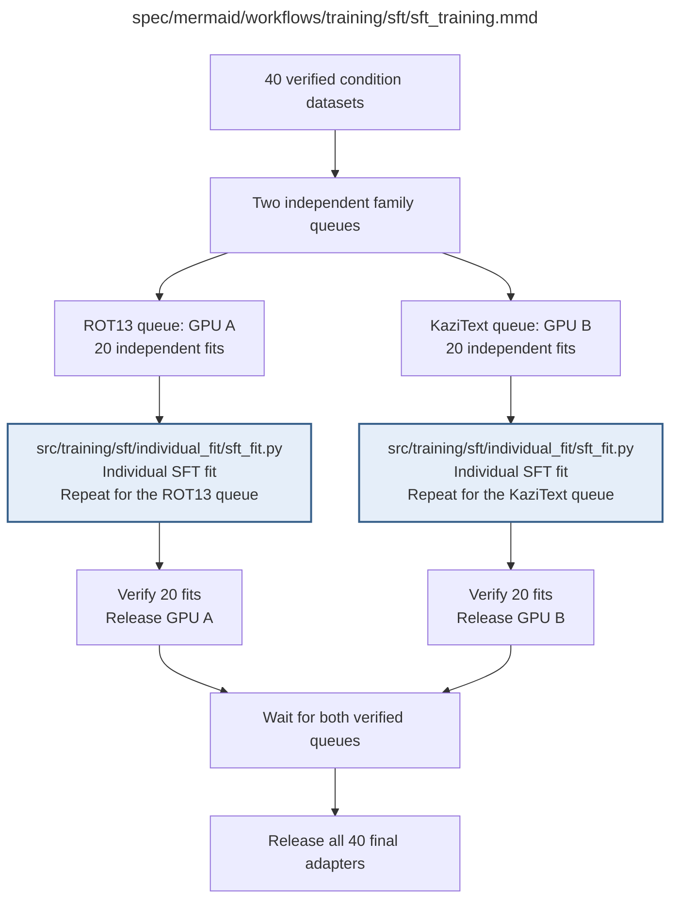

# sft_training.md

**Owner:** `sft`. **Implementation status:** blank placeholder, not implemented or tested.

| Artifact | Exact repository path |
|---|---|
| Implementation | `src/training/sft/sft_training.py` |
| Workflow/support diagram | [`spec/mermaid/workflows/training/sft/sft_training.mmd`](../../../../spec/mermaid/workflows/training/sft/sft_training.mmd) |
| This specification | `docs/modules/training/sft/sft_training.md` |
| Unit test slot | `tests/unit/training/sft/test_sft_training.py` |

**Scientific sources:** C.2; E.1.1–E.1.3; E.2.2,E.2.5. [p. 28](../../../../spec/experiment.pdf#page=28) · [p. 29](../../../../spec/experiment.pdf#page=29) · [p. 30](../../../../spec/experiment.pdf#page=30) · [p. 49](../../../../spec/experiment.pdf#page=49) · [p. 50](../../../../spec/experiment.pdf#page=50) · [p. 54](../../../../spec/experiment.pdf#page=54) · [p. 56](../../../../spec/experiment.pdf#page=56).

## Responsibility and controlling details

Create two independent family queues, one for ROT13 and one for KaziText, each covering both models at ten fixed levels: twenty independent fits per queue and forty total. Both call the same `sft_fit` implementation. Every level initializes from its untouched base; a previous level is not a warm start. Only an exact-fit matching full checkpoint may resume a fit.

Each queue runs its fits sequentially on its assigned GPU, while queues may run concurrently with the single RL queue. A failed fit stops the affected queue and preserves partial results; another independent queue may complete valid work. Mark a fit complete only after its final adapter, fixed validation loss and provenance have verified. Release each GPU when its own queue is complete. The nominal exposure is 20,000 example presentations per fit and approximately 1250 optimizer updates, not a hardcoded substitute for correct batching/epoch semantics.

## Interfaces and dependent procedures

Use the common [artifact contracts](../../../contracts.md), [frozen prompt instructions](../../../prompts.md), [decision ledger](../../../decisions.md) and [validation requirements](../../../validation.md). Typed signatures/serialization are delegated implementation details; their scientific meaning is not. The named owner defines this module with its consumers before dependent integration.

| Source node | Called procedure (exact path) | Specification |
|---|---|---|
| `ROTFIT` | `src/training/sft/individual_fit/sft_fit.py` | [sft_fit](individual_fit/sft_fit.md) |
| `KAZFIT` | `src/training/sft/individual_fit/sft_fit.py` | [sft_fit](individual_fit/sft_fit.md) |

## Original procedural constraints

The following source comments retain the procedural detail of the supplied diagram. Obsolete introductory editing instructions and raw link directives are omitted from this list; all links are resolved in the path-synchronized diagram below. Appendix H controls any earlier conflicting language.
- SFT training schedule
- Each queue covers 7B and 14B at all 10 levels; fits are independent and start from untouched bases.
- Within each queue, select the next unfinished fit until all 20 are verified.
- A failed fit stops that queue and yields a partial report; the other queue may finish valid work.

## Completion and failure boundary

Implement and test `src/training/sft/sft_training.py` against its specified behavior in `tests/unit/training/sft/test_sft_training.py`. Validate every emitted artifact and preserve its source/configuration identity. Do not claim completeness from a placeholder or passing import. Propagate required child failures and maintain ordinary model outcomes separately from infrastructure faults. Mandatory real preflights and permission gates remain in force. Unspecified allowed conventions must be documented/frozen before outcomes; new scientific choices are not silently authorized.

## Exact path-synchronized diagram

The following diagram is byte-for-byte the active `.mmd` content at generation time. Its procedural content is from the supplied workflow or the cited PDF support requirement; file labels and role assignment are the requested repository organization.

