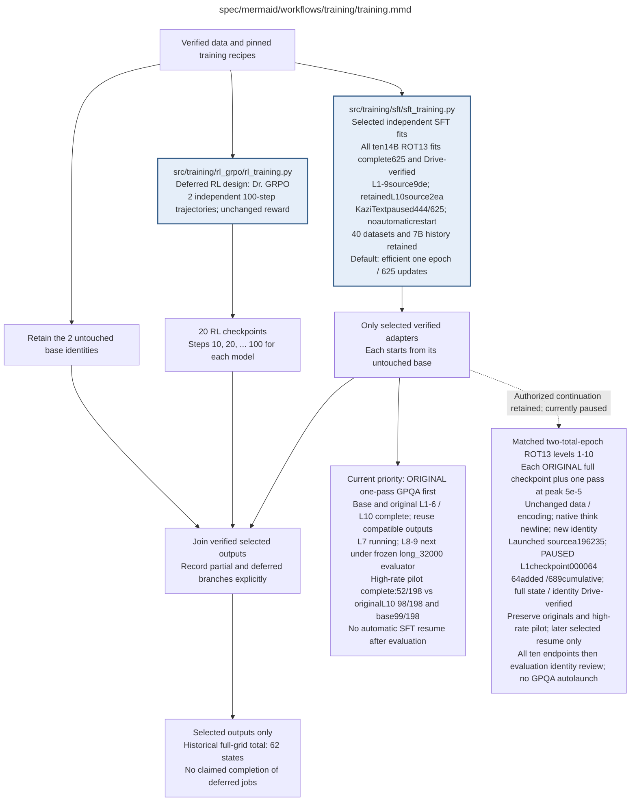

# training.md

**Owner:** `coordinator`. **Current priority:** finish original **one-pass**
14B ROT13 GPQA levels 7–9 first. The matching long-profile baseline and original
levels 1–6 and 10 are complete. Preserve all original adapters and compatible
outputs. The published supervisor launched at 21:56:31.846611 UTC; original
level 7 was confirmed running at 21:56:48.129439 UTC. The scientific evaluator
remains `5e6be1b`; operational supervision uses `2a0f7e2` and retains the two
recorded recoveries. Base and levels 1–6 were revalidated without inference;
original L10's completed receipt is retained. No training restarts automatically
after evaluation. Current status is
`ONE_PASS_GPQA_PRIORITY_RUNNING_LEVEL7_SFT_CONTINUATION_PAUSED64`.

All ten original 14B ROT13 fits completed 625 updates with verified Drive
adapters/full state/results: levels 1–9 retain scientific source
`9de8813031da737453f491723a10b305679dc42d`, original L10 retains
`2ea4fb9a7737cff806226366e73743eec5935fad`. KaziText L10 remains paused at
444/625 with verified recovery and no automatic restart. No other KaziText or
7B completion is implied.

The separate high-rate L10 pilot completed 625 added/1,250 cumulative updates
and 26 Drive-verified artifacts. Its frozen full-198 GPQA result is **52/198
(26.26%)**, versus base **99/198 (50.00%)** and original one-pass L10 **98/198
(49.49%)**. Pilot categories are 52 correct, 44 parsed wrong, 9 malformed and
93 truncated. The fixed 73-word detector finds 168/198 marker-positive
responses, including 34 frozen-correct; this is presence only, not coverage or
reasoning validity. Historical first-128 human and wordfreq diagnostics retain
their prefix denominator. Exposure, schedule restart and native-newline
alignment changed jointly, so no isolated epoch effect is established.

The authorized matched **two-total-epoch** v2 campaign for levels 1–10 adds one
625-update pass from each original full checkpoint at peak `5e-5`, retaining
data/encoding and adding native thinking-newline alignment. Source
`a1962353a4301744dc6db5adafb0e6b212354679` launched at 21:32:26 UTC on
16 October, and level-1 updates were observed. A whole-update `SIGTERM` pause
was requested at 21:54:29 UTC. Campaign and fit are now **`PAUSED` at level-1
checkpoint `000064`**, with 64 added/689 cumulative updates. Full state, manifest
and identity are Drive-verified under checkpoint hash
`eb52d7e7d4a23f8f3ac482e1a5efce2d44e85767428d7a94263caa2bb465a780`.
The GPU was released before evaluation resumed. Future all-ten continuation
remains authorized; no automatic SFT resume is installed.
One GPU is serial; two may own disjoint levels. New matched GPQA requires all
ten verified endpoints and frozen identity review; it does not autolaunch.
See the [continuation policy and commands](sft/sft_training.md#planned-matched-two-total-epoch-campaign-levels-110).

| Artifact | Exact repository path |
|---|---|
| Implementation | `src/training/training.py` |
| Workflow/support diagram | [`spec/mermaid/workflows/training/training.mmd`](../../../spec/mermaid/workflows/training/training.mmd) |
| This specification | `docs/modules/training/training.md` |
| Unit test slot | `tests/unit/training/test_training.py` |

**Scientific sources:** 2; C.2–C.3; E.1.1; E.2.2; H.7,H.9. [p. 2](../../../spec/experiment.pdf#page=2) · [p. 4](../../../spec/experiment.pdf#page=4) · [p. 28](../../../spec/experiment.pdf#page=28) · [p. 29](../../../spec/experiment.pdf#page=29) · [p. 30](../../../spec/experiment.pdf#page=30) · [p. 35](../../../spec/experiment.pdf#page=35) · [p. 49](../../../spec/experiment.pdf#page=49) · [p. 54](../../../spec/experiment.pdf#page=54) · [p. 77](../../../spec/experiment.pdf#page=77) · [p. 80](../../../spec/experiment.pdf#page=80).

## Responsibility and controlling details

The active `efficient_one_epoch_v1` SFT default uses all 10,000 examples once per explicitly selected condition: 625 updates and 19 warmup updates, BF16 base/head, exact full-gradient CCE, SDPA and plain AdamW. Published policy v2 requests physical microbatch 2 × accumulation 8, with capacity fallback 1 × 16 and unchanged effective batch 16. Each optimizer update retains the same ordered 16 examples and per-example weight 1/16; actual batch/accumulation/recomputation is recorded and fixed on resume. All ten 14B ROT13 levels are complete; all ten KaziText conditions remain uncompleted, including the paused level 10. Available data still spans forty model/family/level conditions, and explicit legacy NF4 recipes remain separately identified. See the [training redesign](../../sft_short_pilot.md) and [SFT module](sft/sft_training.md).

The original full matrix comprises forty SFT fits, two independent 100-step RL trajectories with twenty snapshots, and two bases, yielding62 states if every required output exists. This historical accounting is not a current launch instruction. RL and final confirmatory evaluation remain deferred. Preserve the original Sonnet reward, Dr. GRPO semantics and original final evaluation thresholds; this redesign changes only the declared SFT recipe. Never infer completed branches from a join node or relabel old full checkpoints as efficient-run state.

Selected fits start independently from untouched bases, retain disjoint Drive outputs and may run on separate assigned workers after explicit resume. Native model/mask/gradient/capacity/full-state guards execute during normal startup before updates; the completed ROT1314B L10 receipt certifies that condition only, not future startup on another worker or condition. Preserve partial/failed/deferred states honestly.

## Interfaces and dependent procedures

Use the common [artifact contracts](../../contracts.md), [frozen prompt instructions](../../prompts.md), [decision ledger](../../decisions.md) and [validation requirements](../../validation.md). Typed signatures/serialization are delegated implementation details; their scientific meaning is not. The named owner defines this module with its consumers before dependent integration.

| Source node | Called procedure (exact path) | Specification |
|---|---|---|
| `SFT` | `src/training/sft/sft_training.py` | [sft_training](sft/sft_training.md) |
| `RL` | `src/training/rl_grpo/rl_training.py` | [rl_training](rl_grpo/rl_training.md) |

## Original procedural constraints

The following source comments retain the procedural detail of the supplied diagram. Obsolete introductory editing instructions and raw link directives are omitted from this list; all links are resolved in the path-synchronized diagram below. Appendix H controls any earlier conflicting language.
- Training
- Execution contract: known faults use bounded recovery; unclassified/persistent faults stop the worker.
- Frozen invalid inputs are fatal. Unrecoverable child failures propagate; never release incomplete results.
- RL uses the same fixed 800 questions and order for both sizes. Four rollouts form each GRPO group.
- Independent SFT family queues run on their own GPUs; RL model trajectories run sequentially.
- Exact-condition full checkpoints may resume a run; another level's adapter is never a warm start.
- No training-time reasoning ablations. Earlier valid outputs are preserved if a worker stops.
- RL uses GRPO with Dr. GRPO loss normalization and the fixed settings in rl-setup.mmd.
- The post-training GPT4o artifact audit does not change the Sonnet two-pass training reward.

## Completion and failure boundary

Implement and test `src/training/training.py` against its specified behavior in `tests/unit/training/test_training.py`. Validate every emitted artifact and preserve its source/configuration identity. Do not claim completeness from a placeholder or passing import. Propagate required child failures and maintain ordinary model outcomes separately from infrastructure faults. Mandatory real preflights and permission gates remain in force. Unspecified allowed conventions must be documented/frozen before outcomes; new scientific choices are not silently authorized.

## Exact path-synchronized diagram

The following diagram is byte-for-byte the active `.mmd` content at generation time. Its procedural content is from the supplied workflow or the cited PDF support requirement; file labels and role assignment are the requested repository organization.

