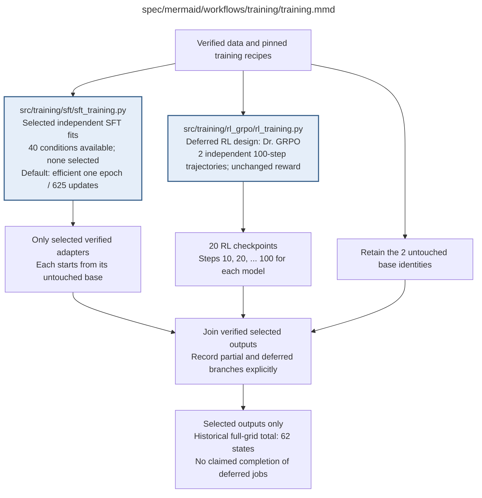

# training.md

**Owner:** `coordinator`. **Current status:** all training paused. The efficient per-fit redesign is implemented; native startup and training remain unrun. Historical full-grid scope is available, but no model, family or level is selected.

| Artifact | Exact repository path |
|---|---|
| Implementation | `src/training/training.py` |
| Workflow/support diagram | [`spec/mermaid/workflows/training/training.mmd`](../../../spec/mermaid/workflows/training/training.mmd) |
| This specification | `docs/modules/training/training.md` |
| Unit test slot | `tests/unit/training/test_training.py` |

**Scientific sources:** 2; C.2–C.3; E.1.1; E.2.2; H.7,H.9. [p. 2](../../../spec/experiment.pdf#page=2) · [p. 4](../../../spec/experiment.pdf#page=4) · [p. 28](../../../spec/experiment.pdf#page=28) · [p. 29](../../../spec/experiment.pdf#page=29) · [p. 30](../../../spec/experiment.pdf#page=30) · [p. 35](../../../spec/experiment.pdf#page=35) · [p. 49](../../../spec/experiment.pdf#page=49) · [p. 54](../../../spec/experiment.pdf#page=54) · [p. 77](../../../spec/experiment.pdf#page=77) · [p. 80](../../../spec/experiment.pdf#page=80).

## Responsibility and controlling details

The active `efficient_one_epoch_v1` SFT default uses all 10,000 examples once per explicitly selected condition: 625 updates and 19 warmup updates, BF16 base/head, exact full-gradient CCE, SDPA and plain AdamW. No condition or GPU is selected; all training remains paused. Available data still spans forty model/family/level conditions, and explicit legacy NF4 recipes remain separately identified. See the [training redesign](../../sft_short_pilot.md) and [SFT module](sft/sft_training.md).

The original full matrix comprises forty SFT fits, two independent 100-step RL trajectories with twenty snapshots, and two bases, yielding62 states if every required output exists. This historical accounting is not a current launch instruction. RL and final confirmatory evaluation remain deferred. Preserve the original Sonnet reward, Dr. GRPO semantics and original final evaluation thresholds; this redesign changes only the declared SFT recipe. Never infer completed branches from a join node or relabel old full checkpoints as efficient-run state.

Selected fits start independently from untouched bases, retain disjoint Drive outputs and may run on separate assigned workers after explicit resume. Native model/mask/gradient/capacity/full-state guards execute during normal startup before updates; no benchmark campaign or already-passed runtime receipt is claimed. Preserve partial/failed/deferred states honestly.

## Interfaces and dependent procedures

Use the common [artifact contracts](../../contracts.md), [frozen prompt instructions](../../prompts.md), [decision ledger](../../decisions.md) and [validation requirements](../../validation.md). Typed signatures/serialization are delegated implementation details; their scientific meaning is not. The named owner defines this module with its consumers before dependent integration.

| Source node | Called procedure (exact path) | Specification |
|---|---|---|
| `SFT` | `src/training/sft/sft_training.py` | [sft_training](sft/sft_training.md) |
| `RL` | `src/training/rl_grpo/rl_training.py` | [rl_training](rl_grpo/rl_training.md) |

## Original procedural constraints

The following source comments retain the procedural detail of the supplied diagram. Obsolete introductory editing instructions and raw link directives are omitted from this list; all links are resolved in the path-synchronized diagram below. Appendix H controls any earlier conflicting language.
- Training
- Execution contract: known faults use bounded recovery; unclassified/persistent faults stop the worker.
- Frozen invalid inputs are fatal. Unrecoverable child failures propagate; never release incomplete results.
- RL uses the same fixed 800 questions and order for both sizes. Four rollouts form each GRPO group.
- Independent SFT family queues run on their own GPUs; RL model trajectories run sequentially.
- Exact-condition full checkpoints may resume a run; another level's adapter is never a warm start.
- No training-time reasoning ablations. Earlier valid outputs are preserved if a worker stops.
- RL uses GRPO with Dr. GRPO loss normalization and the fixed settings in rl-setup.mmd.
- The post-training GPT4o artifact audit does not change the Sonnet two-pass training reward.

## Completion and failure boundary

Implement and test `src/training/training.py` against its specified behavior in `tests/unit/training/test_training.py`. Validate every emitted artifact and preserve its source/configuration identity. Do not claim completeness from a placeholder or passing import. Propagate required child failures and maintain ordinary model outcomes separately from infrastructure faults. Mandatory real preflights and permission gates remain in force. Unspecified allowed conventions must be documented/frozen before outcomes; new scientific choices are not silently authorized.

## Exact path-synchronized diagram

The following diagram is byte-for-byte the active `.mmd` content at generation time. Its procedural content is from the supplied workflow or the cited PDF support requirement; file labels and role assignment are the requested repository organization.

